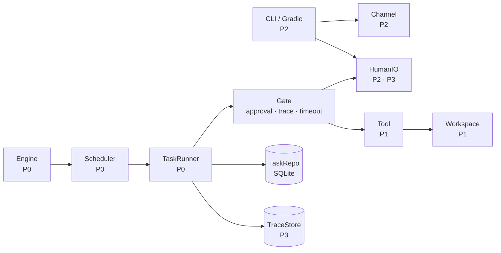

# Moumou Coding Agent

[简体中文](README.md) · [English](README.en.md)

> Moumou is a coding agent. Hand it a task and it decomposes the work itself, assigns
> subtasks to sub-agents, runs them in parallel, and only delivers the final result once
> every subtask has passed acceptance.

Stack: Python 3.11+ · asyncio · SQLite · Pydantic v2 · DeepSeek API

> The Chinese [README.md](README.md) is the authoritative version. This file is a translation.

---

## Project status

| Area | Owner | Status |
| --- | --- | --- |
| Data contracts · task state machine · scheduling · autonomous delegation | P0 | ✅ |
| Human-in-the-loop (approval / question / review) | P0 | ✅ |
| Machine acceptance (command · pytest · file · JSON) | P0 | ✅ |
| Execution log (JSONL, replayable) | P0 | ✅ |
| Context assembly | P0 | 🚧 baseline |
| Memory and experience evolution | P0 | ⬜ |
| Execution sandbox · Git / GitHub · web search | P1 | ⬜ |
| Message bus · CLI | P2 | 🚧 reference impl |
| Persistent storage · task set · metrics | P3 | 🚧 partial |

Legend: ✅ done　🚧 in progress　⬜ not started

Per-member tasks, acceptance commands and milestones live in
**[docs/STATUS.md](docs/STATUS.md)**.

## Capabilities

- **Autonomous decomposition** — not a fixed pipeline; the model decides whether to split,
  how many subtasks to create, and who owns each one
- **No preconfigured role templates** — the model determines and constructs the agent roles
  it needs, then puts them to work
- **Parallel agents** — independent subtasks run concurrently to cut wall-clock time
- **Sandbox isolation** — one private workspace per agent, mutually invisible, so a project
  cannot be corrupted by a neighbouring agent
- **Human-in-the-loop** — risky actions (deleting files, pushing code, installing packages)
  stop and wait for approval
- **Proactive clarification** — the agent asks when the requirement is ambiguous instead of
  guessing
- **Mid-run steering** — a human can steer or redirect a running task through conversation

## Quick start

```bash
git clone https://github.com/Greensheep04/moumou-Agent.git
cd moumou-Agent

# 1. Environment (Python 3.11+)
make install

# 2. No API key needed
make test          # 127 tests
make demo          # full pipeline against a scripted model, finishes in seconds
make demo-memory   # memory loop: a task fails → reflection → the next one reuses it

# 3. Needs a real model (configure the key first, see below)
make smoke    # verify the key and model name
make eval     # run the evaluation set
```

## Configure your API key (one per person)

Please avoid committing any key. `.env` is gitignored; the repository only ships a template.

```bash
cp .env.example .env
# edit .env and put your key after DEEPSEEK_API_KEY=
```

Get one at <https://platform.deepseek.com/api_keys>. The defaults are usually fine:

```ini
DEEPSEEK_API_KEY=your-key
DEEPSEEK_MODEL=deepseek-flash          # stable id for DeepSeek-V4.1-Flash-1017
DEEPSEEK_BASE_URL=https://api.deepseek.com
```

Verify it:

```bash
make smoke
```

It performs three checks: a plain chat round-trip, a request with function calling, and a
listing of the tools the agent advertises. All three passing means the key and model id are
correct. Expected output:

```
[1] plain chat  1.57s   content: 'pong'    tokens: 38 in / 14 out
[2] tool call   1.13s   tool: echo  args={'text': 'hi'}
[3] agent advertises 8 tools: ['ask_human', 'delete_file', ...]
```

## How to plug in

You only need to implement one port; nothing else changes. Full signatures, input/output
fields and implementation conventions are in **[docs/INTERFACES.md](docs/INTERFACES.md)** (Chinese).

| You | Implement | Put it in | Acceptance |
| --- | --- | --- | --- |
| **P1** | `Tool`, `WorkspaceProvider` | `src/moumou/tools/`, `src/moumou/sandbox/` | `pytest tests/test_tool_contract.py` |
| **P2** | `Channel`, `HumanIO` (interactive) | `src/moumou/bus/`, `src/moumou/ui/` | `pytest tests/test_channel_contract.py` |
| **P3** | `TraceStore`, `MemoryStore`, `HumanIO` (scripted) | `src/moumou/store/`, `src/moumou/eval/` | `make eval` |

Three conventions:

1. `src/moumou/contracts/` is frozen for now. If it needs to change, please raise it first so
   three implementations do not have to rework at once.
2. Keep each module's implementation in its own directory; `orchestrator/` stays with the
   orchestration layer.
3. Passing contract tests is the definition of done.

Suggested first day:

- **P1**: extract the path check in `tools/builtin.py` into a standalone `LocalJail` that keeps
  the three `../etc/passwd` contract cases green, then add `git`, `git_push`, `web_search`.
- **P2**: implement a persistent `Channel`, point `make_bus` in the contract test at it, then
  build the CLI.
- **P3**: import `trace.jsonl` into SQLite, then grow the task set from 3 to 15.

## Repository layout

```
src/moumou/
  contracts/     data contracts and port protocols (frozen; see the contract tests first)
  orchestrator/  core: state machine · scheduling · delegation · approval gate · acceptance
  trace/         execution log (JSONL)
  context/       context assembly
  tools/         tool implementations             ← extended by P1
  adapters/      reference implementations        ← replaced by P1/P2/P3
  eval/          task loading · evaluation runner  ← extended by P3
  demo/          runnable demo
eval/tasks/      task set (YAML)                  ← written by P3
docs/            documentation (see below)
tests/           tests, including three interface contract suites
runs/            runtime artifacts (not committed)
```

## Documentation

Every document is available in both Chinese and English.

| Document | Audience | Contents |
| --- | --- | --- |
| [docs/SETUP.en.md](docs/SETUP.en.md) · [中文](docs/SETUP.md) | **new joiners, read first** | Dependencies, `.env`, verification, commands |
| [docs/INTERFACES.en.md](docs/INTERFACES.en.md) · [中文](docs/INTERFACES.md) | **anyone implementing a port** | Port signatures, input/output formats, conventions |
| [docs/STATUS.en.md](docs/STATUS.en.md) · [中文](docs/STATUS.md) | everyone | Module progress, per-member tasks, milestones |
| [docs/ARCHITECTURE.en.md](docs/ARCHITECTURE.en.md) · [中文](docs/ARCHITECTURE.md) | anyone curious about the design | Mechanism rationale, diagrams, known limits |
| [docs/EVAL.en.md](docs/EVAL.en.md) · [中文](docs/EVAL.md) | P3 | Task format, metric definitions, how to run |
| [docs/FAQ.en.md](docs/FAQ.en.md) · [中文](docs/FAQ.md) | everyone | Environment, key, git and test pitfalls |
| [docs/roles/](docs/roles/) | P1 / P2 / P3 | One detailed brief per teammate, bilingual |
| [CHANGELOG.en.md](CHANGELOG.en.md) · [中文](CHANGELOG.md) | everyone | What each milestone delivered |

## Architecture in one picture



**Rectangles are the orchestration core; rounded boxes are external implementations.** The core
only reaches them through six ports — swap any implementation and nobody else edits a line.

---

> Environment and configuration: [docs/SETUP.md](docs/SETUP.md) ·
> [docs/SETUP.en.md](docs/SETUP.en.md)
