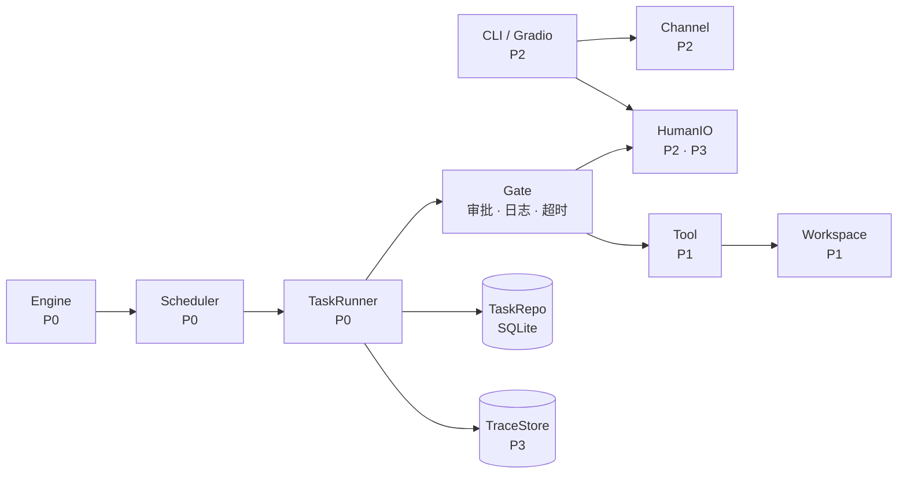

# Moumou Coding Agent

[简体中文](README.md) · [English](README.en.md)

> Moumou 是一个 Coding Agent。把任务交给它，它会自己拆解、分配给子代理，并行推进，
> 每个子任务都验收通过之后，才把最终结果交付给你。

技术栈：Python 3.11+ · asyncio · SQLite · Pydantic v2 · DeepSeek API

---

## 项目状态

| 模块 | 负责人 | 状态 |
| --- | --- | --- |
| 数据契约 · 任务状态机 · 调度 · 自主委派 | P0 | ✅ |
| 人类介入（审批 / 提问 / 审阅） | P0 | ✅ |
| 机器验收（命令 · pytest · 文件 · JSON） | P0 | ✅ |
| 执行日志（JSONL，可回放） | P0 | ✅ |
| 上下文组装 | P0 | 🚧 基础版 |
| 记忆与经验进化 | P0 | ⬜ |
| 执行沙箱 · Git / GitHub · 联网搜索 | P1 | ⬜ |
| 消息总线 · 命令行界面 | P2 | 🚧 参考实现 |
| 持久化存储 · 评测题库 · 指标报告 | P3 | 🚧 部分 |

图例：✅ 完成　🚧 进行中　⬜ 未开始

各成员的具体任务、验收方式和里程碑见 **[项目状态详细版](docs/STATUS.md)**。

## 核心能力

- **自主拆解**：不是固定流水线，模型自己判断该不该拆、拆几个、谁来做
- **无预置角色模板**：由模型自己判定并构建合适的 AI 智能体，高效完成工作
- **支持智能体并行处理任务**，提高工作效率
- **沙箱隔离**：每个智能体一个独立工作区，互不可见，保证项目安全性
- **人类介入**：高风险动作（删文件、推代码、装依赖）停下来等人批准
- **主动提问**：遇到需求歧义时直接问，而不是猜
- **执行中可引导**：支持在执行过程中，人工通过对话引导方向、改变方向

## 快速开始

```bash
git clone https://github.com/Greensheep04/moumou-Agent.git
cd moumou-Agent

# 1. 环境（Python 3.11+）
make install

# 2. 不需要 API key 就能跑
make test     # 65 个测试
make demo     # 完整链路演示，用假模型，秒级完成

# 3. 需要真模型（先配 key，见下一节）
make smoke    # 验证 key 和模型名
make eval     # 跑评测集
```

依赖安装、`.env` 配置与验证步骤详见 **[环境配置文档](docs/SETUP.md)**。

## 配置 API Key（每人配自己的）

key 请勿提交到仓库。`.env` 已在 `.gitignore` 中，仓库只保留模板。

```bash
cp .env.example .env
# 编辑 .env，把你的 key 填到 DEEPSEEK_API_KEY=
```

去 <https://platform.deepseek.com/api_keys> 申请。默认参数一般不用改：

```ini
DEEPSEEK_API_KEY=你的key
DEEPSEEK_MODEL=deepseek-flash          # DeepSeek-V4.1-Flash-1017 的稳定 ID
DEEPSEEK_BASE_URL=https://api.deepseek.com
```

验证：

```bash
make smoke
```

它会做三件事：发一次普通对话、发一次带 function calling 的请求、列出框架注册的工具。
三项都过说明 key 和模型名都没问题。正常输出：

```
[1] plain chat  1.57s   content: 'pong'    tokens: 38 in / 14 out
[2] tool call   1.13s   tool: echo  args={'text': 'hi'}
[3] agent advertises 8 tools: ['ask_human', 'delete_file', ...]
```

## 怎么接进来

只需要实现其中一个端口即可，其余部分无需改动。完整的签名、输入输出字段与实现约定见
**[接口说明](docs/INTERFACES.md)**。

| 你 | 要实现 | 放哪 | 验收命令 |
| --- | --- | --- | --- |
| **P1** | `Tool`、`WorkspaceProvider` | `src/moumou/tools/`、`src/moumou/sandbox/` | `pytest tests/test_tool_contract.py` |
| **P2** | `Channel`、`HumanIO`（真人版） | `src/moumou/bus/`、`src/moumou/ui/` | `pytest tests/test_channel_contract.py` |
| **P3** | `TraceStore`、`MemoryStore`、`HumanIO`（脚本版） | `src/moumou/store/`、`src/moumou/eval/` | `make eval` |

三点约定：

1. `src/moumou/contracts/` 目前处于冻结状态，如需调整建议先同步，避免三份实现同时返工
2. 各模块的实现放在各自目录下，`orchestrator/` 由编排层维护
3. 契约测试通过即可视为完成

上手建议（第一天）：

- **P1**：把 `tools/builtin.py` 的路径检查抽成独立的 `LocalJail`，让契约测试里那三个
  `../etc/passwd` 用例依然绿，再补 `git` / `git_push` / `web_search`
- **P2**：实现一个持久化的 `Channel`，把 `test_channel_contract.py` 里的 `make_bus`
  指过去，然后做 CLI
- **P3**：把 `trace.jsonl` 导进 SQLite，然后把题库从 3 道补到 15 道

## 目录结构

```
src/moumou/
  contracts/     数据契约与端口协议（冻结，改动前先看契约测试）
  orchestrator/  编排核心：状态机 · 调度 · 委派 · 审批闸门 · 验收
  trace/         执行日志（JSONL）
  context/       上下文组装
  tools/         工具实现                 ← P1 扩展
  adapters/      各端口的参考实现         ← P1/P2/P3 替换
  eval/          题库加载 · 评测运行器     ← P3 扩展
  demo/          可运行演示
eval/tasks/      题库（YAML）             ← P3 编写
docs/            文档（见下）
tests/           测试，含三份接口契约测试
runs/            运行时产物（不进仓库）
```

## 文档

| 文档 | 给谁看 | 内容 |
| --- | --- | --- |
| [环境配置](docs/SETUP.md) | **新加入的人，先看这个** | 依赖、`.env`、验证步骤、常用命令 |
| [接口说明](docs/INTERFACES.md) | **接入模块的人，先看这个** | 6 个端口的签名、输入输出格式、实现约定 |
| [项目状态](docs/STATUS.md) | 所有人 | 各模块进度、各成员任务、里程碑 |
| [架构说明](docs/ARCHITECTURE.md) | 想理解设计的人 | 机制原理、流程图、已知边界 |
| [评测说明](docs/EVAL.md) | P3 | 题库格式、指标口径、怎么跑 |
| [常见问题](docs/FAQ.md) | 所有人 | 环境、key、git、测试的坑 |
| [任务书](docs/roles/) | P1 / P2 / P3 | 各自的一份详细分工 |
| [更新日志](CHANGELOG.md) | 所有人 | 每个里程碑做了什么 |

## 一句话架构



**方框是编排核心，圆角框是外部实现。** 核心只通过 6 个端口调用外部代码——
换掉任何实现，其他人不用改一行。

---

> 环境与配置文件说明：[环境配置文档](docs/SETUP.md)（[English](docs/SETUP.en.md)）
