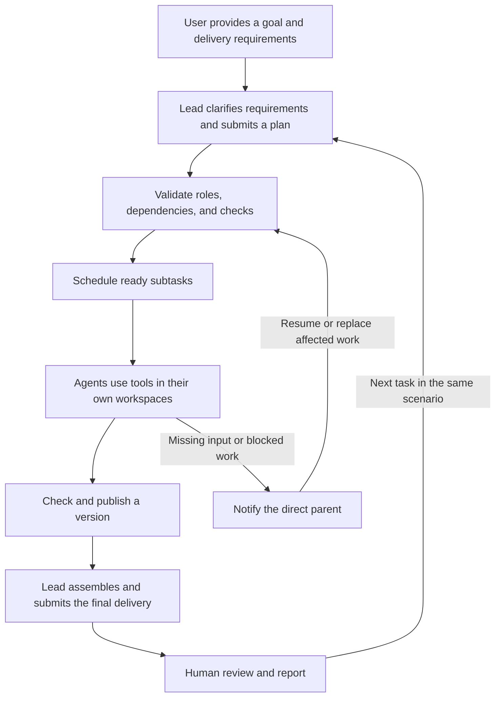

# Moumou Agent Architecture

[简体中文](ARCHITECTURE.md) · [Command-line guide](SETUP.en.md)

## Task lifecycle

The command line loads user-provided Markdown tasks and teams. The general Python engine can also receive a goal directly. SQLite stores task relationships, status, roles, published versions, human decisions, and memory. The scheduler picks ready nodes. Each worker builds a request for its current node and runs through model calls, tools, and submissions.

| Source directory | Responsibility |
| --- | --- |
| `orchestrator/` | Validate plans, schedule dependencies, run nodes, recover blocked work, and check results |
| `context/`, `memory/` | Select request context, compact history, and retrieve lessons by role |
| `workspace/`, `sandbox/`, `tools/` | Allocate directories, run tools, and scope file and process operations |
| `contracts/`, `bus/`, `trace/`, `store/` | Define task and message structures and store collaboration state and evidence |
| `adapters/`, `config.py` | Connect model and human interfaces and read settings and usage data |
| `eval/`, `ui/` | Load consecutive tasks, handle human interaction, and save reports and replays |

## Delegation, concurrency, and recovery

The lead calls `submit_plan` with each subtask's goal, role, dependencies, and checks. The general engine starts with a lead. The model can reuse registered roles or propose a role with a reason and a tool list. The Markdown team runner uses roles declared by the task author and takes the first role as the lead. In either entry point, the lead decides how to assign the work. The framework validates roles, tools, dependency cycles, and limits on task count and depth.

Tasks whose inputs are ready can run in parallel. In continuous team runs, the same role uses its workspace in sequence. Test preparation can run alongside development, and checks on a candidate wait for the designated developer delivery. A later task keeps the team and scenario identity and receives the declared files and confirmed rules from the preceding task.

The framework reports missing dependency files and versions before work starts. In team runs with targeted recovery enabled, a subtask can use `report_blocked` to tell its direct parent what it needs and what it has done. The lead can resume the original node or name it in `replaces`. Replacement updates pending dependencies. Root acceptance uses the active nodes, while history keeps prior attempts. A recovered node carries forward its spent budget.

## Context, memory, and cache use

The opening request includes role and tool rules, the goal, confirmed user answers, dependency versions, and relevant lessons. Each agent retains its own tool history. Handoffs carry the files and summaries another agent needs. Long-term lessons are retrieved by project and role, and team handoffs keep their own scope.

Calls reuse stable opening messages and tool definitions. Step counts, time remaining, and closeout notices are appended when needed. Providers with prefix caching can reuse matching input at the start of the request. A task change, a new confirmed answer, or compaction can change that prefix. Cache statistics use hit and miss counts reported by the provider.

Long tool outputs enter the conversation as a short preview with a reference that can be read again. At the compaction threshold, the framework shortens older tool results and drops the oldest complete turns first. It prioritizes the opening rules, recent steps, and error evidence. Routine compaction makes no extra model call. The runner checks request capacity before sending and reports a capacity problem if essential context cannot fit.

For official DeepSeek, the command-line defaults are a 600,000-token compaction trigger, a 400,000-token target, and a 610,000-token per-request cap. These are estimated input counts including tool definitions. The cumulative node budget adds usage across the node's model requests and responses.

## Workspaces and tool permissions

The continuous runner allocates a workspace for each scenario, task, and role. Agents use file tools within their own directories. The framework imports declared files from published versions into downstream workspaces. Path handling checks boundaries, links, and reserved framework areas. Tool access and approval policy are controlled by the framework.

With the macOS workspace sandbox available, Shell and Python use the selected workspace, a restricted process environment, and a separate temporary directory. Ordinary commands and in-workspace cleanup can proceed automatically. Automatic commands may use local loopback, with external networking restricted. Dependency installation, explicit external access, and pushes involve human decisions. The sandbox still enforces write boundaries after approval. It permits access to system tools and libraries and applies separate restrictions to other roles' run files and `.env`.

Where the workspace sandbox is unavailable, `auto` requests human approval for Shell and Python. In manual mode, file tools still check paths. Shell and Python run with the launcher's OS permissions. Use a controlled container or virtual machine when process-level isolation is required.

## Delivery, automated checks, and review

An agent submits a delivery list and any files needed for acceptance. The framework stages the candidate, checks dependency versions, paths, and hashes, and runs conditions such as file presence, content matching, and command exit status. For a missing test script, it reports the path and declaration issue so the agent can correct the submission. Passed files are published under a version identifier. Its manifest records paths, sizes, and SHA-256 hashes.

Downstream nodes import a named version. The framework reports missing files, path conflicts, and hash mismatches before proceeding. QA records the version under test and the result. When a scenario requires independent QA, the framework checks that evidence against the final files. Human review records a separate judgment about the goal and output quality. Reports show the automated and human decisions separately.

## Models, search, timing, and records

The CLI supports official DeepSeek and HKGAI profiles and defaults to buffered requests. The client handles transient transport issues within the call timeout according to its retry policy. Tavily and SerpApi are selectable. Search allowance is shared within a scenario. Reads of registered sources, quote checks, and new search requests are recorded separately. These records support source tracing, while reviewers judge the content against the task.

A scenario budget covers consecutive tasks, and the lead can estimate time for each task. Each node also has step, cumulative token, and execution time limits. The framework records real waits for clarification, approval, and review separately. As the deadline approaches, the worker prompts the team to finish checks and deliver. The default execution limits are 1,800 seconds per scenario and 300 seconds per node. Both can be configured from the CLI.

Each run keeps a manifest, model and tool traces, dialogue, human decisions, and version evidence. The optional `--research-progress` summarizes sources already read. The optional `--execution-progress` flags a successful Shell or Python call repeated with the same arguments and an unchanged workspace in the same attempt. An agent can give a reason to execute it again under the usual approval policy.
