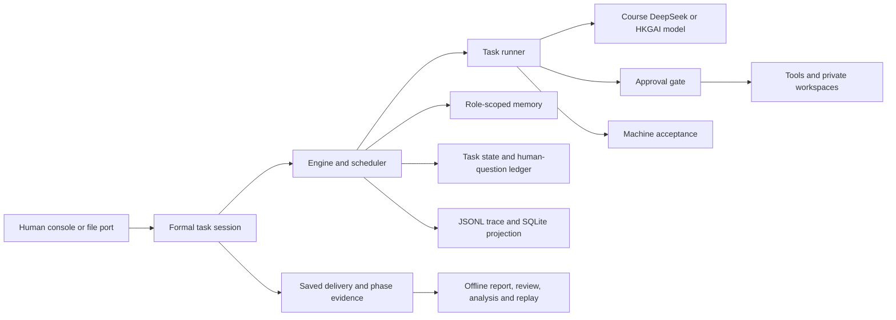
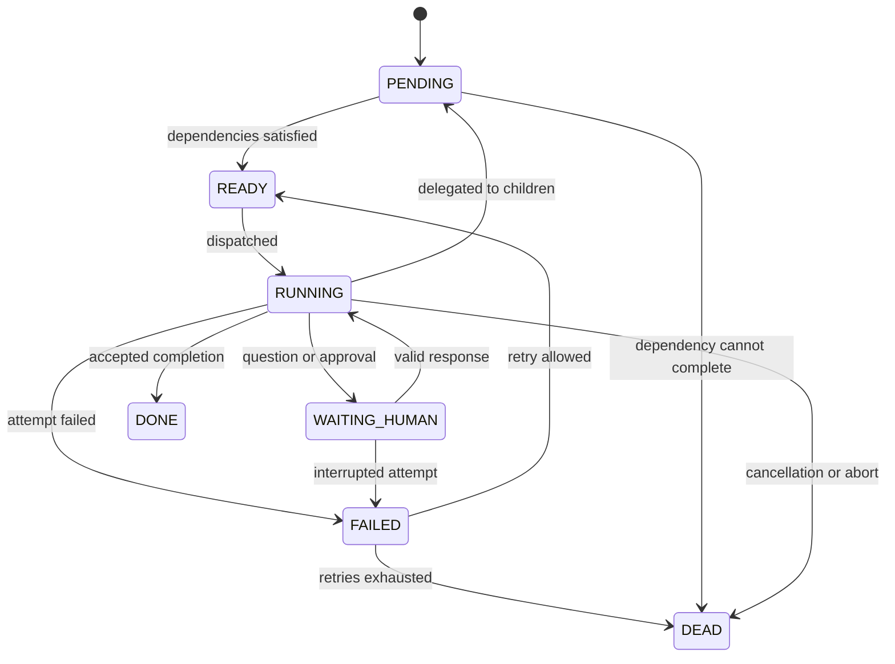

# System architecture

[简体中文](ARCHITECTURE.md) · [English](ARCHITECTURE.en.md)

Moumou turns a human request into a persisted task graph. Agents can clarify the
request, delegate work, execute tools in private working directories and return
declared artifacts. Machine acceptance, agent completion and reviewed goal quality
are separate observations.

This document describes the implementation. The latest context-recovery, trace and
evaluation additions still require regression execution and actual task evaluation;
their presence in the code is not an acceptance result.

## Runtime components

| Component | Files | Responsibility |
| --- | --- | --- |
| Contracts | `src/moumou/contracts/` | Task, role, message, tool, human and storage interfaces |
| Orchestration | `src/moumou/orchestrator/` | State transitions, scheduling, delegation, approvals and acceptance |
| Context and memory | `src/moumou/context/`, `src/moumou/memory/` | Admission, compaction, retrieval, reflection and scoring |
| Tools and workspaces | `src/moumou/tools/`, `src/moumou/sandbox/`, `src/moumou/workspace/` | Files, subprocesses, Git, search and artifact integration |
| Interaction adapters | `src/moumou/adapters/`, `src/moumou/eval/human.py` | Channel/HumanIO adapters and recorded dialogue |
| Trace storage | `src/moumou/trace/recorder.py`, `src/moumou/store/trace.py` | Journal, exact-task queries and SQLite recovery |
| Formal evaluation | `src/moumou/eval/` | Original sources, continuing teams, accounting and offline evidence |

`Engine` accepts injected tool, workspace, channel, human and memory implementations.
Its default task state uses SQLite. Extension conventions are defined in
[INTERFACES.en.md](INTERFACES.en.md).

## One task's execution

1. The Engine persists a root task and changes it from `PENDING` to `READY`.
2. The scheduler dispatches eligible tasks, subject to its slot limit, as `RUNNING`.
3. The runner resolves its workspace, materializes explicit dependency artifacts,
   restores recorded clarification and assembles context.
4. The model can call tools, ask a human, submit a result or propose a plan.
5. The framework validates plans before creating children. A delegated parent becomes
   `PENDING` with child dependencies and runs again after they complete.
6. Submitted files are validated, machine criteria are evaluated and accepted declared
   files are published through the integration contract.
7. Terminal tasks generate conclusion-board notes and eligible memory maintenance.
8. The formal session saves delivery evidence and obtains a human quality decision,
   or retains unknown quality when review is deferred.

The diagram highlights common paths; `LEGAL_TRANSITIONS` in `contracts/task.py` is
the complete authority. State changes and their audit events share one transaction.
Restart recovery uses stored state and remaining retry budget; it does not convert an
interrupted execution into success.

## Delegation and identity

A plan declares roles, subtask goals, acceptance and dependencies. Validation checks
role/tool permissions, dependency existence, acyclicity and size/depth limits. The
general Engine supports generated roles up to configured limits.

The formal adapter installs exactly the four original members of each scenario,
refuses additional identities and serializes concurrent work for the same member.
Each member keeps a private role directory and stable agent ID across sequential tasks.

| Data | Scope |
| --- | --- |
| Role definition and long-term lessons | project + role |
| Conclusion board | project + conversation + role |
| Recorded clarification | project + conversation + task + role |
| Trace query | exact task ID within the saved run |
| Formal team workspace | scenario project + conversation + stable role ID |

Generic Engine instances use `role@task` runtime IDs with the existing project-role
memory policy. That sharing differs from the formal team's stable logical identities;
universal per-runtime-instance memory separation is not claimed. Separate scenario/run
directories and databases isolate formal teams.

## Context and human decisions

Both context builders preserve the full current role, goal, acceptance and recorded
same-task answers. Optional dependency reports, lessons and board/history content
yield first. If mandatory content cannot fit, `ContextAdmissionError` stops admission
before a model call.

The formal adapter saves auxiliary context in private
`.evaluation/context/<digest-prefix>.json` archives. New filenames use a 32-hex prefix,
with full SHA-256 references and collision checks. These are framework evidence,
not delivered project artifacts.

Questions are persisted before waiting. After delegation, retry or process recovery,
the runner restores answered exchanges into its pinned opening. Supported human ports
resume an original scoped pending question or recover its consumed response without
inventing a request ID. Missing or conflicting evidence fails explicitly. Tool approvals
remain fresh per action; rejection feedback returns in that action's tool result.

See [CONTEXT-MEMORY.en.md](CONTEXT-MEMORY.en.md) for admission and evolution.

## Execution, artifacts and isolation

Tools pass through the Gate, which applies action-class approval policy and records
structured results/spans. Formal evaluation also requires approval for Git staging and
committing. Tavily search has a shared per-scenario allowance; school model access is
accounted separately.

Artifacts are explicit workspace-relative paths. Dependencies do not share whole
directories or make transitive files available. Missing input must be delivered through
the integration interface or clarified.

Local path validation is application isolation, not an operating-system security
sandbox: arbitrary executed code can have broader host access. Native Windows process
management and the internal evaluation supervisor have their own cleanup bounds.
The interactive formal session uses cooperative node limits and tool/model timeouts,
not a universal hard process deadline.

## Evidence and evaluation

The default source is the instructor's original Markdown: three teams and six root
goals. The retained fifteen supplementary goals use the same protocol and require
explicit selection. Results from the sources stay separate.

Each fresh run records source/code/configuration identity, dialogue, human exchanges,
task results, trace and search accounting. New delivery captures add selected immutable
file copies, active memory metadata and recorded failure events. Scenario-close
snapshots can include unfinished nodes as diagnostics; they are not deliveries or
extra goals. Old missing captures remain unknown.

Recorder flushes JSONL before its SQLite projection. Projection failure remains visible
and falls back to the journal; valid reopening imports missing events. The files do not
share a transaction. Automatic span parents describe the runtime call hierarchy,
separate from task dependencies.

Offline tools validate saved evidence without rerunning agents or acceptance:

- `eval.report`: plan denominator, timing, raw/effective quality and saved evidence.
- `eval.review`: explicit append-only human decisions and supersession history.
- `eval.analysis`: failure and memory observations without inferred causal benefit.
- `eval.replay`: original source-linked records for a P2 consumer.

Task-stage failure or quality rejection skips later dependent work in its group and
allows independent groups to continue. Setup/configuration, cleanup failure or global
cancellation stops the suite. Unposted and unreviewed goals remain in the original plan.

A `DONE` node with no machine criteria is self-report. Reviewed quality requires its own
evidence; a regression result, memory record or export does not establish that all
instructor goals passed or a teammate accepted the integration.

## Delivery references

- [Setup](SETUP.en.md)
- [Evaluation workflow](EVAL.en.md)
- [Metrics](metrics.md)
- [Shared interfaces](INTERFACES.en.md)
- [P3 responsibility](roles/P3-data-and-evaluation.en.md)