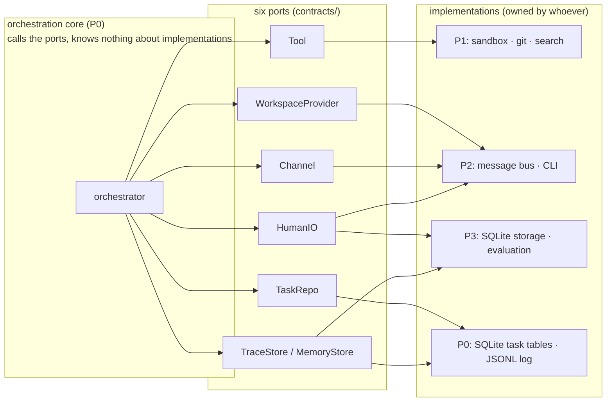
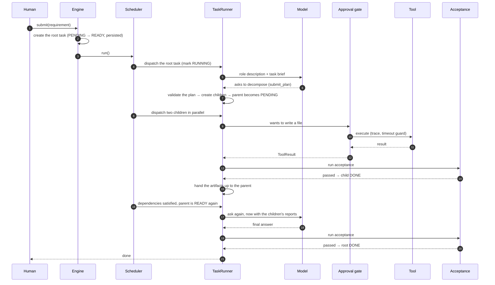
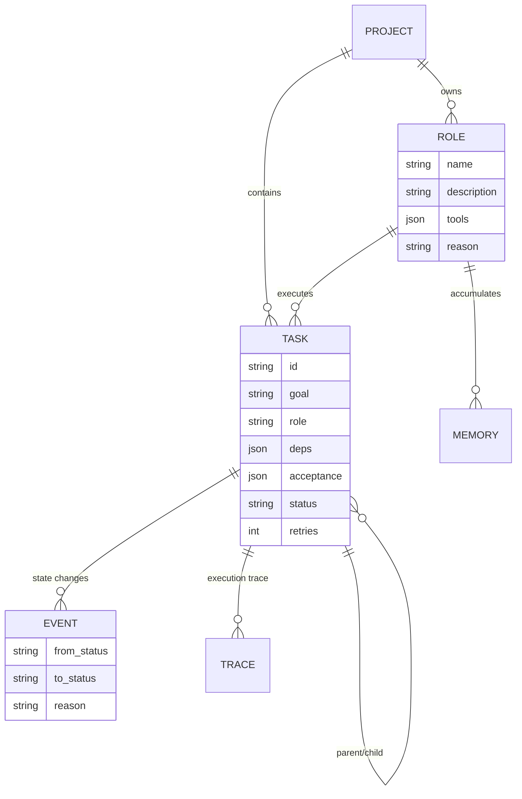
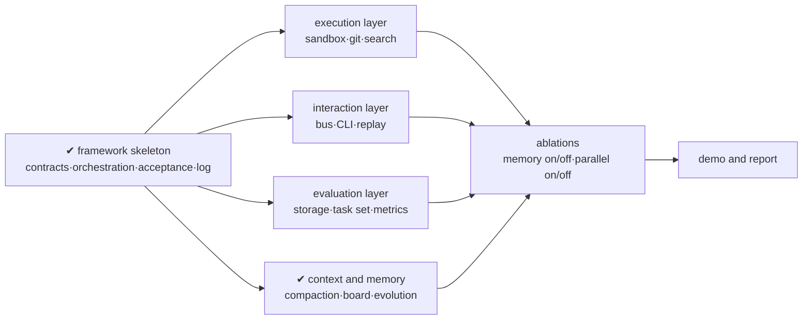

# Architecture

[简体中文](ARCHITECTURE.md) · [English](ARCHITECTURE.en.md)

> This document is written for two kinds of reader: anyone who wants to understand quickly how
> the system turns, and the teammate who needs to plug a module into it.
> Jargon is kept to a minimum: each mechanism first explains *why it is needed*, then *how it is
> built*.

> The Chinese [ARCHITECTURE.md](ARCHITECTURE.md) is the authoritative version.
> This file is a translation.

---

> The rest of this document covers why it ended up shaped this way, the principle behind each of
> the six mechanisms, and where your module plugs in.

## 1. In one sentence

> A user states a requirement, the agents decide for themselves whether to split it and who does
> what, each works in its own isolated workspace, and the framework decides whether the job is
> actually done using **executable checks** — delivering only after acceptance passes, and
> recording the whole run as a replayable log.

## 2. Why it is shaped this way

Four people building four directions in parallel: the biggest risk is not that something cannot
be written, it is **stepping on each other**.

So the first version contained no business logic, only boundaries: **the contract layer holds
data, the orchestration layer holds flow, the concrete implementation is injected from outside.**
This is called ports and adapters (hexagonal architecture); in code it is six `Protocol`s.



**There is one test for whether a boundary is right**: swap any implementation for another — does
anyone else have to change code? If not, the boundary is right.

## 3. The journey of one task



In words, that is eight steps:

1. **Create**: the framework creates a root task, persists it, `PENDING → READY`
2. **Schedule**: the scheduler unblocks dependencies, picks a runnable task, marks it `RUNNING`,
   starts a coroutine
3. **Prepare**: resolve the role, allocate an isolated workspace, copy upstream artifacts in
4. **Assemble context**: role description + task brief + acceptance criteria + upstream reports
5. **Loop**: ask the model → if it wants a tool, run it through the approval gate → feed the
   result back → ask again
6. **Accept**: the model says it is done; run the machine checks; pass is `DONE`, fail is `FAILED`
7. **Unblock**: when every child is `DONE`, the parent becomes `READY` again
8. **Review**: the parent runs once more with the children's reports and confirms the whole

## 4. The six mechanisms

### 4.1 The task state machine: one progress marker solves four problems

People often build separate machinery for "pause", "retry", "parallel" and "delegation". They are
all the same thing: **which state is the task currently in**.

| Requirement | How the state machine expresses it |
| --- | --- |
| Wait for approval | `RUNNING → WAITING_HUMAN`, and back to `RUNNING` once answered |
| Retry after failure | `RUNNING → FAILED → READY` (attempts left) or `→ DEAD` (none left) |
| Run in parallel | tasks without dependencies are `READY` at the same time and are dispatched together |
| Hand off to children | the parent goes `RUNNING → PENDING`, and its `deps` are rewritten to the child ids |
| Process crashed | on restart, leftover `RUNNING` tasks are picked back up as `READY` |

The important part is **transactional persistence**: every state change must write the task row
and insert the audit event in the same transaction. Split them and a crash in between leaves the
event log contradicting the task table, which makes the timeline in the report self-contradictory.

> Counter-example: if state only lived in memory, "pause" would really mean "the program is stuck",
> and a restart would lose everything.

### 4.2 Delegation: the model proposes, the framework decides

The model does not write free text for us to parse. It **calls a `submit_plan` tool** whose
argument shape is generated from a Pydantic model, so it has to fill in the schema.

A submitted plan must pass four checks before anything is created:

1. no cycles (topological sort)
2. every dependency key exists
3. each role is either already known or declared in this plan
4. at most 6 subtasks, at most 2 levels deep

**Why "propose and decide" rather than "let the model decide everything"**: models are good at
judging *how to split*; they are not good at guaranteeing *the result is a legal graph*. Give them
the first job, give the code the second.

The parent does not just walk away: its dependencies are rewritten to the child ids, and once all
children finish it **runs again** with their reports in context, judging whether the whole meets
the bar.

### 4.3 Roles: look before you create, and permissions only shrink

Roles are not hard-coded; the model invents them during decomposition. Left unconstrained that
causes two problems:

- **role explosion**: `coder` / `code_writer` / `programmer` as three near-identical roles, which
  fragments the experience
- **self-granted permissions**: a role that declares "I may git push without approval"

Two corresponding limits:

| Problem | Limit |
| --- | --- |
| Role explosion | the existing roster is shown to the model first (reuse if possible); a new role **must justify itself**; at most 8 roles per project |
| Self-granted permissions | a role may only **select a subset** of the tool set; whether approval is needed depends on `action_class`, not on the role |

### 4.4 Context: why the whole group chat cannot go in

Once four agents are talking, feeding every message to every agent explodes the token count, and
most of it is noise.

So each agent's context is **assembled separately**:

| Layer | Contents |
| --- | --- |
| Role | who I am, my responsibility, my rules |
| Brief | goal + acceptance criteria + upstream reports |
| Memory | historical lessons for similar tasks (implemented, see [Context and Memory](CONTEXT-MEMORY.md)) |
| Dialogue | only the messages that concern me |

One more principle: **artifacts are the only thing that crosses a workspace boundary**. A file
written by agent A does not appear for agent B automatically; only when B declares a dependency on
A do A's declared artifacts get copied into B's workspace.

### 4.5 Approval and questions: one port, three shapes

Human involvement really has three forms, but they share one interface, `HumanIO.ask()`:

| Shape | Situation | Returns |
| --- | --- | --- |
| `approval` | I want to delete a file or push code — may I? | approve / reject |
| `question` | the requirement is ambiguous, which file did you mean? | free text |
| `review` | I suggest changing this role definition, is that okay? | approve / reject + a note |

**The real value of this abstraction is testability**: the same interface is wired to a terminal
for a human during a demo, and to `ScriptedHuman` answering from YAML during batch evaluation.
Without it, every task that needs human confirmation would be excluded from automated testing, and
half of the completion-rate metric would be meaningless.

### 4.6 Acceptance: why it must be executable

"Completion rate" easily degenerates into a slogan. The approach here is that **an acceptance
criterion is a structure, not a sentence**.

```python
Acceptance(kind="command", target="python3 hello.py", expect="0")
Acceptance(kind="file_contains", target="README.md", expect="hello")
Acceptance(kind="json_key", target="pkg.json", expect="scripts.test=pytest")
```

Because it is executable it can run automatically; because it runs automatically the completion
rate is computed rather than felt. The model may write its own criteria, but only in these forms —
"the code is good quality" is not a legal criterion.

## 5. Boundaries and known limits

To be honest, these are **not** fully solved yet:

| Limit | Current state | Impact |
| --- | --- | --- |
| Workspace isolation | application-level path checks | stops `../`, does not stop malicious code reading the disk directly; a Docker backend can close this |
| Artifact integration | file copy | no version history, the later writer wins on conflict; P1's branch merge will replace it |
| Task set | 3 samples | 12 short of 15 |
| Reflection quality | backed by scoring and eviction | a bad lesson that keeps being cited needs several failures before it drops out |

Stating the boundary plainly scores better than pretending — when the demo is asked "does this
isolation really hold", the answer is this table.

## 6. Where your module plugs in

| You | Ports | Files | How it is accepted |
| --- | --- | --- | --- |
| P1 | `Tool`, `WorkspaceProvider` | `src/moumou/tools/`, `src/moumou/sandbox/` | `pytest tests/test_tool_contract.py` |
| P2 | `Channel`, `HumanIO` | `src/moumou/bus/`, `src/moumou/ui/` | `pytest tests/test_channel_contract.py` |
| P3 | `TraceStore`, `MemoryStore`, `HumanIO` | `src/moumou/store/`, `src/moumou/eval/` | `make eval` |

The three contract suites are **"still green after you swap the implementation"**. They test
interface behaviour, not your internals — so refactor freely; as long as they pass, the framework
can drive your code.

## 7. What the data looks like



Three fields worth calling out:

- `deps`: dependencies stated explicitly, which is what lets the scheduler compute "who can run now"
- `acceptance`: structured, therefore executable
- `reason` (on a role): forces the model to explain why the existing roles are not enough — this
  single field measurably reduces role explosion

## 8. Roadmap


