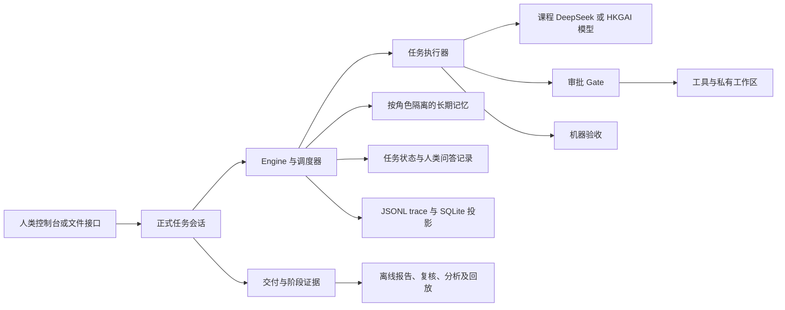
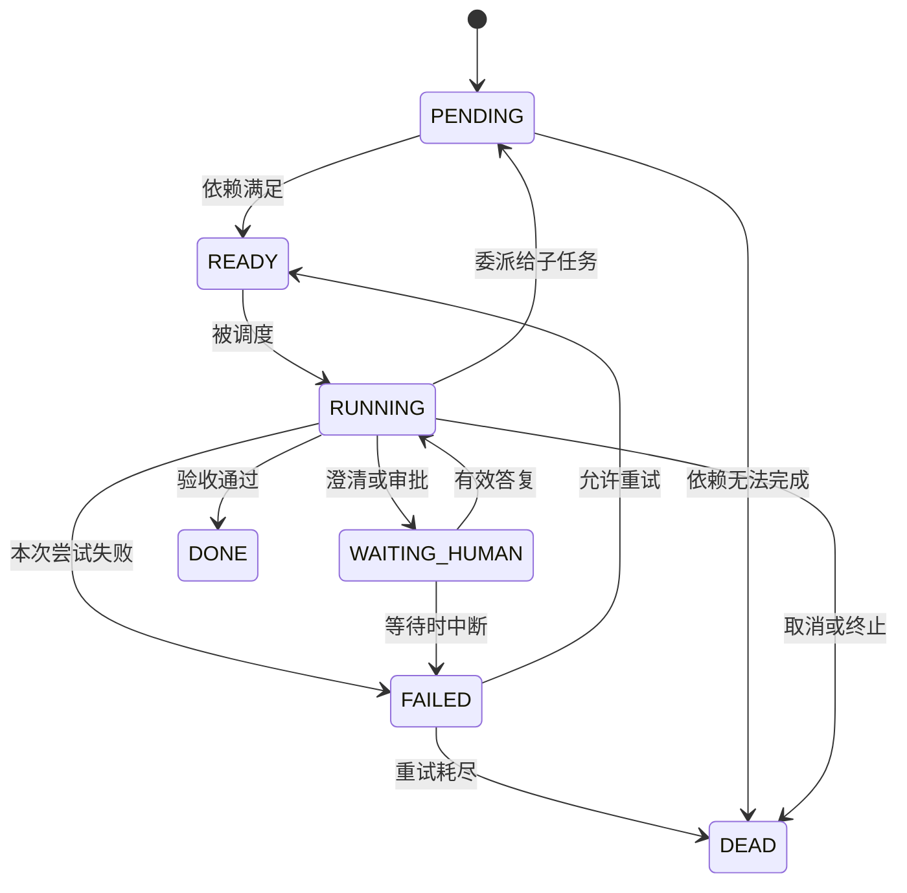

# 系统架构

[简体中文](ARCHITECTURE.md) · [English](ARCHITECTURE.en.md)

Moumou 将人的要求转换为可持久化的任务图。Agent 可以主动澄清要求、委派子任务、在私有工作目录中执行工具，并通过显式声明的文件交付成果。Agent 完成状态、机器验收与人工复核的目标质量分别记录。

本文描述当前实现。回归、真实任务和内容复核分别绑定其实际源码版本；实现存在不等于任务质量通过。版本身份、检查结果和未解决问题见[性能与验证报告](PERFORMANCE.md)。

## 运行组件

| 组件 | 文件 | 责任 |
| --- | --- | --- |
| 契约 | `src/moumou/contracts/` | 任务、角色、消息、工具、人类及存储接口 |
| 编排 | `src/moumou/orchestrator/` | 状态转换、调度、委派、审批与验收 |
| 上下文和记忆 | `src/moumou/context/`、`src/moumou/memory/` | 内容准入、压缩、检索、反思和评分 |
| 工具和工作区 | `src/moumou/tools/`、`src/moumou/sandbox/`、`src/moumou/workspace/` | 文件、子进程、Git、搜索与产物整合 |
| 交互适配 | `src/moumou/adapters/`、`src/moumou/eval/human.py` | Channel/HumanIO 适配和完整对话记录 |
| Trace 存储 | `src/moumou/trace/recorder.py`、`src/moumou/store/trace.py` | 日志、精确任务查询及 SQLite 恢复 |
| 正式评测 | `src/moumou/eval/` | 原始题源、连续团队、指标与离线证据工具 |

`Engine` 支持注入工具、工作区、Channel、HumanIO 和记忆实现，默认任务状态保存在 SQLite。扩展约定见[接口说明](INTERFACES.md)。

## 一个任务如何执行

1. Engine 持久化根任务，将其从 `PENDING` 变为 `READY`。
2. 调度器根据依赖与并发槽位选出任务，将其变为 `RUNNING`。
3. 执行器分配工作区、接收显式依赖产物、恢复已有澄清，并组装上下文。
4. 模型可以调用工具、询问人类、提交结果或提出任务拆分计划。
5. 框架校验计划后创建子任务。父任务变为 `PENDING`，依赖改为子任务 ID，子任务完成后父任务再次运行。
6. 框架校验声明的文件，执行机器验收，再通过工作区整合接口发布已通过验收的显式产物。
7. 任务终止后写入结论板，并执行符合条件的长期记忆维护。
8. 正式会话保存交付证据并获得人工质量判断；延期复核时保留未知质量。

图中列出常见路径，完整合法转换以 `contracts/task.py` 的 `LEGAL_TRANSITIONS` 为准。状态变化和对应审计事件在同一事务中写入。重启恢复依据持久状态与剩余重试次数执行，不会把中断改写成成功。

## 委派和身份范围

计划包含角色、子目标、验收和依赖。框架检查角色/工具权限、依赖存在性、无环性及数量/深度限制。通用 Engine 可以在配置上限内生成新角色。

正式题源适配器固定使用每个场景原有的四名成员，拒绝新增身份，同一成员的并发任务串行执行。每名成员在该场景的连续任务中使用稳定 Agent ID 和独立角色目录。

| 数据 | 范围 |
| --- | --- |
| 角色定义、长期经验 | project + role |
| 结论板 | project + conversation + role |
| 人类澄清记录 | project + conversation + task + role |
| Trace 查询 | 当前运行内的精确 task ID |
| 正式团队工作区 | 场景 project + conversation + 稳定 role ID |

通用 Engine 使用 `role@task` 运行实例 ID，但保留 project-role 记忆共享策略。它与正式团队的稳定逻辑身份不同，不能宣称所有运行实例的记忆都独立。正式场景和不同运行通过各自的目录、数据库隔离。

## 上下文与人类决定

通用和正式团队上下文都保留完整当前角色、目标、验收及同任务已答信息。委派任务另保留从根到直接父任务的原始目标引用：Worker 只沿当前仓库的 `parent_id` 校验身份、project、conversation、深度与环，不从依赖或历史阶段推测祖先。完整引用及其 UTF-8 SHA-256 属于固定开场的必需内容；依赖报告、经验、结论板与历史等可选内容先让出预算。必需内容无法容纳或委派 builder 丢弃引用时，`ContextAdmissionError` 在模型调用前明确拒绝准入。

目标引用与子任务自己的目标、角色和验收分开，保留原限定与未知项，不自动裁决冲突。它只传递祖先原目标，不传递父任务私有人答、审批、记忆、结果或文件，也不增加工具权限或搜索额度。Task 2 即使依赖上一阶段，作为根任务也没有祖先引用。重新进入、同任务答复刷新及压缩仍保留必需引用；这证明信息可用，不证明模型实际采用或结论正确。

正式适配器将完整辅助上下文及精确祖先目标记录保存在私有 `.evaluation/context/<digest-prefix>.json` 中；只有祖先引用时也会归档。新文件名取 32 位十六进制前缀，引用保留完整 SHA-256，并检查同名不同内容冲突。这些是框架证据，不属于交付项目文件。

问题在等待前持久化。委派、重试或进程恢复后，执行器把原已答信息恢复到固定开头。支持恢复的 HumanIO 可以继续原范围内的待答问题，或取回已消费答复，保留原请求 ID；缺失或冲突记录会明确失败。工具审批仍按每次操作重新进行，拒绝理由随当次工具结果返回模型。

准入与记忆机制见[上下文和记忆](CONTEXT-MEMORY.md)。

## 执行、产物与隔离

工具经过 Gate，根据操作类别执行审批策略并记录结构化结果和 span。正式评测也要求 Git 暂存、提交经过审批。Tavily 搜索由场景内成员和连续任务共享配额，学校模型访问额度单独计量。

产物必须显式声明工作区相对路径。依赖不会共享整个目录，也不会自动传递间接依赖文件；缺失输入需要通过整合接口明确交付或向人类澄清。

本地路径检查属于应用级隔离，不是操作系统安全沙箱：任意执行代码仍可能访问更广的宿主资源。原生 Windows 进程管理及内部评测监督器有各自的清理边界。正式交互会话使用协作式节点限制与工具/模型超时，不提供等待人类期间的统一强制进程截止时间。

## 证据与评测

仓库唯一随附题源是 `eval/tasks/` 的老师 mid-test 原始 Markdown：三个团队、六个根目标。协议仍可显式加载兼容的外部 Markdown 题源，历史或外部结果不与老师成绩混算。

每场新运行记录题源/代码/配置身份、对话、人类问答、任务结果、trace 和搜索用量。新交付另保存所选文件的不可变副本、有效记忆元数据与失败事件。场景收尾快照可以保留未完成节点，属于诊断，不增加交付数或目标数。旧运行缺少快照时保持未知。

Recorder 先刷新 JSONL，再更新 SQLite 投影。投影失败会显式记录并退回原日志查询；有效日志可在重开时补导入缺失事件。两份文件不共享事务。自动 span 父子关系表示调用层级，与任务依赖关系分开。

以下离线工具校验保存的证据，不重跑 Agent 或验收：

- `eval.report`：计划分母、耗时、原始/有效质量及已存证据。
- `eval.review`：真实显式人工判断、只追加的复核和替代历史。
- `eval.analysis`：失败及记忆观察，不推定因果收益。
- `eval.replay`：面向 P2 的原始记录与来源索引。

任务阶段普通失败或质量拒绝会跳过本组后续依赖，但继续其他独立组。初始化/配置、资源清理失败或全局取消会停止整场。尚未发布和尚未复核的目标仍保留在原计划中。

没有机器验收条件的 `DONE` 属于自述完成。质量须有自己的复核证据；回归结果、记忆记录或导出文件不能证明老师全部目标通过，也不能代替同伴接口签收。

## 公开证据与最终交付检查

正式老师Engine把公开研究保存在场景级来源库，与角色私有目录、记忆及不可变交付快照分开。计次搜索记录实际查询、请求、角色/任务、URL、摘要和原时间；`source_history`供四角色复用，`read_source`补充有界原文和读取/网络来源，不发出新搜索。仅允许已登记公共来源和明确同文档格式；失败仍是失败，摘要及成功读取均不自动证明主张正确。

老师上下文保留原角色/题目，并追加通用的主张—原文、日期/单位及独立复算流程。根交付hook在验收和发布前检查显式文件引用，要求模型纠正缺失/未声明配套文件，不自动发布私有或推测文件。打包证据与语义质量分开，不伪造人工接受。显式研究复用保留旧时间并在manifest单列，不导入旧人答、产物、记忆或评分。

## 交付入口

数据交接使用显式图边：模型计划逐项填写 `deps`，遗漏在委派改变状态前收到可纠正反馈；Python 计划默认值保持兼容。框架不从文字猜依赖，也不保证模型填写的图边在语义上正确。

Gate 通过独立的类型化反馈把真实批准 NOTE 送到角色后续观察，保留请求/调用/范围身份，不改工具内容通道或扩大授权。问题答复历史、审批和独立内容验收分别留存。

公开来源把不可变 raw/text 及检索元数据版本与最新 URL 缓存指针分开。每次实际 GET 保留自身身份和日期，缓存/分页不是新抓取。仅回填可核验的旧库当前行，早已丢失的版本保持不可得；原文完整性与操作员补充观测不等于主张准确。

`verify_source_quote` 使用已保存的 `metadata_sha256` 在当前来源库核对字面引文。操作员在配置团队后，将工具一次性绑定到提供方返回的实际角色路径，不猜 LocalDirs 或 Git 工作树布局。工具只读精确历史版本，不发 HTTP、不搜索、不回退最新网页；默认逐码点匹配，可显式仅归一空白。匹配、不匹配和证据未知分别返回 `true`、`false`、`null`，坐标明确属于保存的提取文本或空白归一后的派生文本。字面匹配不等于事实、归属、日期口径或人工质量通过。

- [安装与运行](SETUP.md)
- [评测流程](EVAL.md)
- [指标说明](metrics.zh-CN.md)
- [共享接口](INTERFACES.md)
- [P3 责任](roles/P3-数据与评测层.md)
