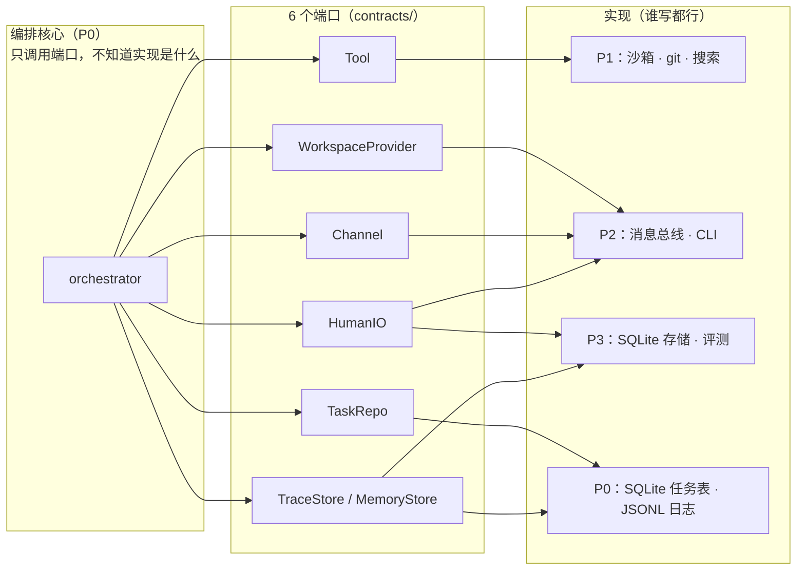
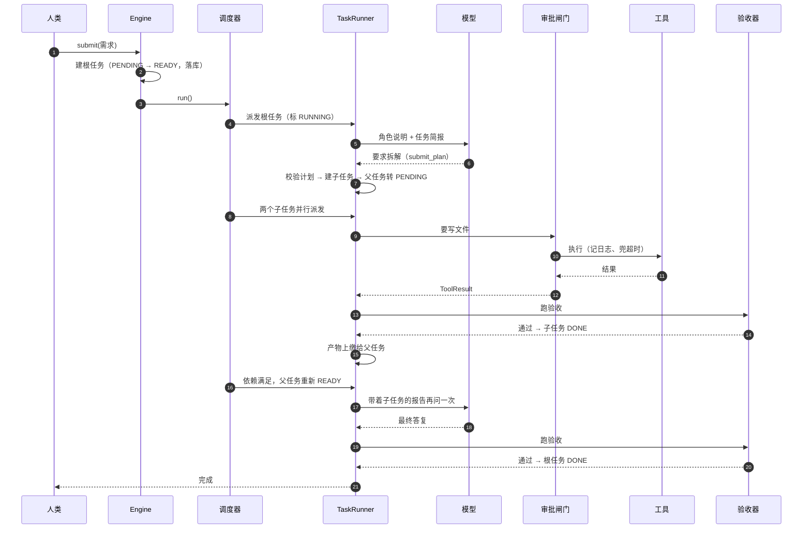
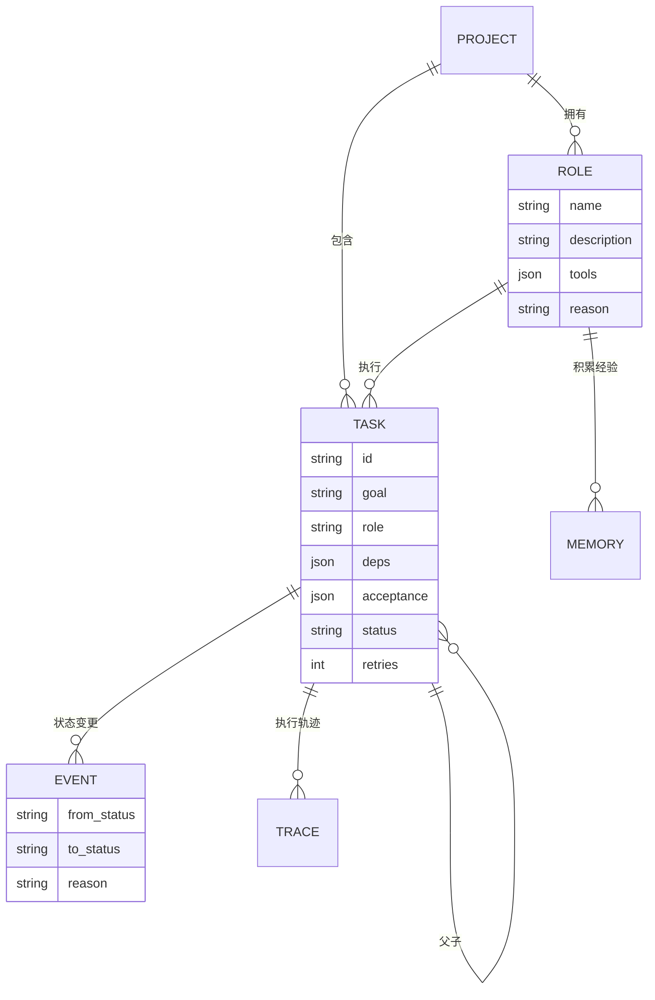
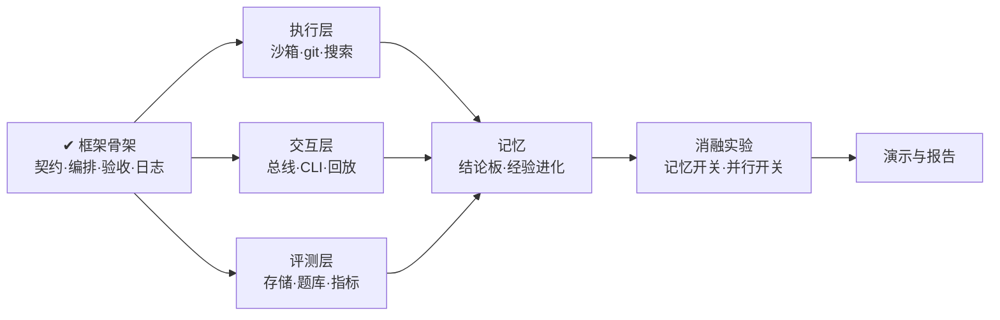

# 架构说明

> 这份文档写给两种人：想快速理解系统怎么转的人，以及要往里面插自己模块的组员。
> 尽量少用术语，每个机制都会先说“为什么需要它”，再说“怎么实现的”。

---

> 剩下的章节讲的是：它为什么长成这个形状，六个机制各自的原理，以及你的模块从哪里插进来。

## 1. 一句话

> 用户提一个需求，Agent 自己判断要不要拆、拆给谁，各自在独立工作区里干活，
> 最后由框架用**可执行的检查**判断做没做完，验收通过才交付，全过程记成可回放的日志。

## 2. 为什么长成这个形状

四个人要并行开发四个方向，最大的风险不是写不出来，而是**互相踩**。

所以第一版代码没写业务，先写边界：**契约层只放数据，编排层只放流程，具体实现从外面注入。**
这个做法叫端口-适配器（Hexagonal Architecture），落到代码里就是 6 个 `Protocol`。



**检验边界对不对，只用一招**：把任何一个实现换成另一个，其他人要不要改代码？
不用改，说明边界是对的。

## 3. 一次任务的旅程



用文字讲就是 8 步：

1. **建任务**：框架建一个根任务，落库，状态 `PENDING → READY`
2. **调度**：调度器解锁依赖、挑出可跑的任务、标成 `RUNNING`、起一个协程
3. **准备**：找到角色、分配独立工作区、把上游产物拷进来
4. **组装上下文**：角色说明 + 任务简报 + 验收项 + 上游报告
5. **循环**：问模型 → 它要调工具就跑工具（过审批闸门）→ 结果回填 → 再问
6. **验收**：模型说干完了，跑机器检查，通过就是 `DONE`，不通过就是 `FAILED`
7. **解锁**：子任务全 `DONE`，父任务重新变 `READY`
8. **复核**：父任务带着子任务的报告再跑一遍，确认整体结果

## 4. 六个机制的原理

### 4.1 任务状态机：一块进度牌解决四件事

很多人会给“暂停”“重试”“并行”“委派”各写一套机制。其实它们都是同一件事：
**任务当前处在哪个状态**。

| 需求 | 用状态机怎么表达 |
| --- | --- |
| 等人批准 | `RUNNING → WAITING_HUMAN`，人答完 `→ RUNNING` |
| 失败了重试 | `RUNNING → FAILED → READY`（还有次数）或 `→ DEAD`（用完） |
| 多人并行 | 没依赖的任务同时是 `READY`，调度器一起派 |
| 拆给子任务 | 父任务 `RUNNING → PENDING`，它的依赖重写成子任务 id |
| 进程崩了 | 重启时把残留的 `RUNNING` 捡回 `READY` |

关键在**落库的原子性**：每次翻牌，`UPDATE 任务表` 和 `INSERT 事件表` 必须在同一个事务里。
分开写，进程崩在中间，事件日志就会和实际状态对不上，报告里的时间线会自相矛盾。

> 反例：如果状态只存在内存里，那“暂停”就真的只是“程序卡住了”，重启即全丢。

### 4.2 委派：模型提议，框架裁决

模型不写自由文本让我们去解析，而是**调用一个 `submit_plan` 工具**，
参数形状由 Pydantic 模型生成，模型必须按 schema 填。

模型交上来的计划，要过四道检查才允许落地：

1. 有没有环（拓扑排序）
2. 依赖的 key 是否真的存在
3. 要的角色是已有的，还是这次声明的
4. 子任务数量 ≤ 6、嵌套深度 ≤ 2

**为什么是“提议 + 裁决”而不是“让模型全权决定”**：模型擅长判断“该怎么拆”，
但不擅长保证“拆出来是合法的图”。让它负责前者，代码负责后者。

父任务不是甩手就走：它的依赖被重写成子任务 id，等子任务全完成，它会**再跑一遍**，
这时上下文里带着子任务的报告，由它判断整体是否达标。

### 4.3 角色：先查后建，权限只能缩小

角色不是写死的，是模型在拆解时现场发明的。但“随便造”会出两个问题：

- **角色爆炸**：`coder` / `code_writer` / `programmer` 三个近义角色，经验反而碎片化
- **权限自授**：模型造一个角色声明“我可以直接 git push 不需要审批”

对应的两道限制：

| 问题 | 限制 |
| --- | --- |
| 角色爆炸 | 拆解前先把已有角色名单喂给模型（能用就用）；新建**必须填理由**；项目内上限 8 个 |
| 权限自授 | 角色只能从工具全集里**挑子集**，不能扩大；要不要审批由 `action_class` 决定，跟角色无关 |

### 4.4 上下文：为什么不能把群聊全塞进去

四个 Agent 一聊起来，如果把所有消息都塞给每个 Agent，token 会立刻爆掉，而且大部分是噪声。

所以每个 Agent 的上下文是**分开组装的**：

| 层 | 内容 |
| --- | --- |
| 角色 | 我是谁、我的职责、我的规则 |
| 简报 | 目标 + 验收项 + 上游报告 |
| 记忆 | 同类任务的历史经验（待实现） |
| 对话 | 只有和我相关的消息 |

还有一个原则：**产物是唯一能跨工作区边界的东西**。
Agent A 写的文件不会自动出现在 Agent B 那里；只有当 B 声明依赖 A 时，
A 声明的产物才会被拷进 B 的工作区。

### 4.5 审批与提问：同一个端口，三种形态

人类介入其实有三种，但它们共用一个接口 `HumanIO.ask()`：

| 形态 | 场景 | 返回 |
| --- | --- | --- |
| `approval` | 我要删文件 / 推代码，能吗？ | 同意 / 拒绝 |
| `question` | 需求有歧义，你说的“那个文件”是哪个？ | 自由文本 |
| `review` | 我建议改一下这个角色的定义，你看行吗？ | 同意 / 拒绝 + 意见 |

**这个抽象的真正价值在测试**：同一个接口，演示时接命令行由真人回答，
批量评测时接 `ScriptedHuman` 按 YAML 自动回答。
没有它，所有带人工确认的任务都没法进自动化测试，完成率指标直接废一半。

### 4.6 验收：为什么必须是可执行的

“完成率”这个词很容易变成一句空话。这里的做法是：
**验收项是结构体，不是一句话**。

```python
Acceptance(kind="command", target="python3 hello.py", expect="0")
Acceptance(kind="file_contains", target="README.md", expect="hello")
Acceptance(kind="json_key", target="pkg.json", expect="scripts.test=pytest")
```

因为可执行，所以能自动跑；因为能自动跑，所以完成率是算出来的，不是感觉出来的。
模型也可以自己写验收项，但只能写这些形式——写“代码质量良好”是不合法的。

## 5. 边界与已知限制

诚实地说，这些现在**没有**做到位：

| 限制 | 现状 | 影响 |
| --- | --- | --- |
| 工作区隔离 | 应用层路径越界检查 | 挡得住 `../`，挡不住恶意代码直接读盘。Docker 后端可以补 |
| 产物整合 | 文件复制 | 没有版本历史，冲突时后者覆盖。P1 的 git 分支合并会替换 |
| 记忆 | 只有数据模型 | 经验还不会跨任务累积 |
| 上下文 | 无配额、无压缩 | 长任务会超 token |
| 评测集 | 3 道样例 | 离 15 道还差 12 道 |

写清楚边界比假装做到了更得分——答辩时被问“你们这个隔离真能防住吗”，
能直接指着这张表回答。

## 6. 你的模块插在哪

| 你 | 端口 | 文件 | 验收方式 |
| --- | --- | --- | --- |
| P1 | `Tool`、`WorkspaceProvider` | `src/moumou/tools/`、`src/moumou/sandbox/` | `pytest tests/test_tool_contract.py` |
| P2 | `Channel`、`HumanIO` | `src/moumou/bus/`、`src/moumou/ui/` | `pytest tests/test_channel_contract.py` |
| P3 | `TraceStore`、`MemoryStore`、`HumanIO` | `src/moumou/store/`、`src/moumou/eval/` | `make eval` |

三份契约测试是**“换了实现也必须全绿”**的。它测的是接口行为，不是你的内部写法——
所以你可以自由重构，只要测试绿，框架就能驱动你的代码。

## 7. 数据长什么样



三个值得单独说的字段：

- `deps`：显式写出依赖，调度器才能算“现在谁可以跑”
- `acceptance`：结构化，所以能自动执行
- `reason`（在角色上）：强制模型解释“为什么现有的角色不够用”，这一行能显著减少角色爆炸

## 8. 路线


