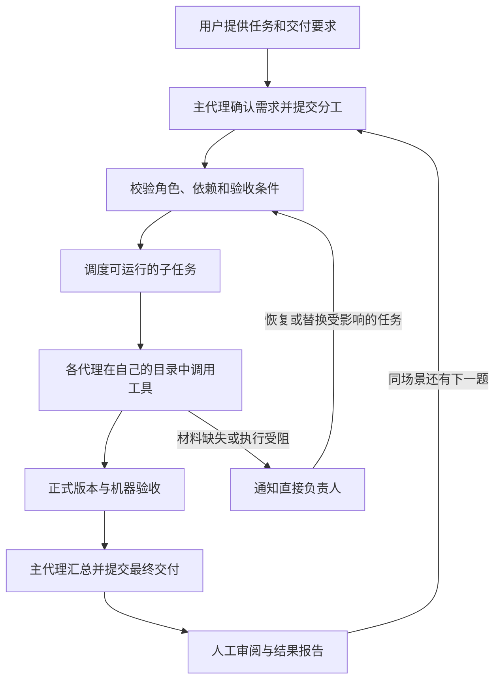

# Moumou Agent 技术文档

[English](ARCHITECTURE.en.md) · [命令行使用指南](SETUP.md)

## 一次任务怎样完成

命令行加载用户提供的 Markdown 任务和团队。通用 Python 编排入口也可以直接接收一个目标。SQLite 保存任务关系、状态、角色、发布版本、人工决定和记忆。调度器读取就绪状态，执行器为当前节点组装请求，在模型、工具和提交之间循环。

| 代码目录 | 设计职责 |
| --- | --- |
| `orchestrator/` | 校验分工、调度依赖、执行节点、处理阻塞和验收 |
| `context/`、`memory/` | 选择每轮信息、整理历史、按角色检索经验 |
| `workspace/`、`sandbox/`、`tools/` | 建立目录、运行工具、限制文件与进程操作 |
| `contracts/`、`bus/`、`trace/`、`store/` | 定义消息和任务结构，保存进程内协作所需的状态与证据 |
| `adapters/`、`config.py` | 连接模型与人工接口，读取配置和模型用量 |
| `eval/`、`ui/` | 加载连续任务、处理人机交互、保存报告与回放 |

## 分工、并行和恢复

主代理通过 `submit_plan` 定义子任务的目标、角色、依赖和验收条件。通用入口从一个负责人开始，模型可复用已注册角色，也可提出新角色并说明其职责与工具。Markdown 团队入口使用任务作者声明的角色，首个角色负责协调。两种入口均由主代理决定具体分工，框架检查依赖环、授权角色、可用工具及数量和深度限制。

输入就绪的任务可以并行。在连续团队模式下，同一角色对其工作目录的操作按顺序执行。测试准备可以与开发同时开始，验证候选产物时等待指定的开发交付。下一题保留同一场景和团队身份，并按声明接收上一题的正式文件及确认规则。

当依赖材料缺失时，框架在执行前报告缺失的文件和版本。启用定向恢复的团队任务中，子任务可通过 `report_blocked` 告知直接负责人缺什么及已有进展。恢复可以继续原节点，或用 `replaces` 替换受影响节点。替换更新等待中的依赖。根任务按有效节点收尾，历史尝试仍留在记录中。恢复沿用节点已使用的预算。

## 上下文、记忆和缓存

开场请求包含角色与工具规则、当前目标、确认过的用户答复、依赖版本与可用经验。工具历史按代理记录，交接传递当前任务所需的文件和摘要。长期记忆按项目和角色检索。

模型调用沿用稳定的开场消息和工具定义。步数、剩余时间和收尾提醒只在需要时附加到对话中。这个布局让支持前缀缓存的模型服务能复用开头相同的输入。切换任务、更新已确认的信息或整理历史时，请求前缀可能改变。报告依据服务返回的命中和未命中用量统计。

工具输出过长时，对话保留简短预览和可重新读取的引用。达到请求压缩阈值时，优先缩短旧工具结果，再移除最早的完整回合，优先保留开场约束、近期步骤和错误证据。常规压缩无需额外的模型摘要调用。发送前再次检查请求容量，必要时继续整理。关键上下文仍无法放入时，框架报告容量问题。

DeepSeek 官方配置在命令行默认使用 60 万 token 压缩触发值、40 万目标与 61 万单次发送上限。这些是含工具定义的输入估算值。节点累计 token 预算累计该节点每次请求与回复的用量。

## 工作区与工具权限

连续团队模式按场景、题目和角色分配工作目录。各代理通过文件工具访问自己的目录。交接由框架把声明的文件从发布版本导入消费者目录。路径解析会检查越界、链接和框架保留区域。角色的工具清单与审批规则由框架控制。

在可用的 macOS 工作区沙箱中，Shell 和 Python 使用指定目录、受限进程环境与独立临时目录。日常命令和区内清理可以自动执行。自动命令允许本机回环通信，对外网络访问受限。依赖安装、显式外部访问和推送涉及人工决定。审批后，工作区沙箱仍执行文件写入边界。系统工具与库可被读取，运行目录中的其他角色文件与 `.env` 受到单独限制。

在工作区沙箱不可用的环境，`auto` 会为 Shell 和 Python 请求人工审批。手动审批下，文件工具仍执行路径检查，Shell 和 Python 依赖运行进程的系统权限。需要进程级隔离时，应在受控容器或虚拟机中运行。

## 交接、机器验收与人工审阅

代理提交交付清单与验收辅助文件。框架把候选文件复制到验收区，检查依赖版本、路径和哈希，使用文件存在、内容检查、命令退出状态等条件验证。缺少命令所需脚本时，反馈文件位置和声明问题，以便修正后再提交。通过检查的文件以编号发布，发布清单记录路径、大小与 SHA-256。

下游从指定版本导入，发现缺失、同路径冲突或哈希不符时先报告问题。QA 记录被测版本和执行结果。要求独立 QA 的场景会核对最终文件与当前版本的测试证据。最后的人类审核记录对题目与产物质量的判断。命令行报告分别展示机器验收与人工审阅。

## 模型、搜索、计时与记录

命令行提供官方 DeepSeek 与 HKGAI 配置。默认使用缓冲式请求。短暂传输错误在当前请求的超时限额内按客户端策略处理。Tavily 和 SerpApi 并列可选。搜索预算按场景共享，读取已登记来源、引用核对与新的搜索请求分别记账。来源登记和引用一致性帮助追溯事实依据，内容判断由具体任务的审阅完成。

场景预算覆盖连续任务，主代理可为每题提交时间估计。节点仍有步骤、累计 token 和执行时间上限。等待实际人工澄清、审批和审阅的时段单独记录。临近场景截止时，执行器提示完成已有检查和交付。默认场景执行上限为 1,800 秒，单节点为 300 秒，可通过命令行修改。

每场运行保存清单、模型与工具追踪、对话、人工决定和版本证据。可选的 `--research-progress` 汇总已读取的资料，`--execution-progress` 对同次尝试中已成功、参数相同且工作区未变化的 Shell 或 Python 请求给出重复提示。确需再次执行时，代理提供理由并沿用原审批规则。
