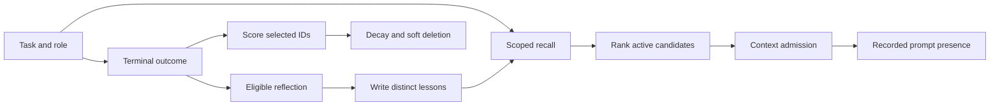

# Context and memory design

[简体中文](CONTEXT-MEMORY.md) · [English](CONTEXT-MEMORY.en.md)

Context controls what the model receives during an attempt. Long-term memory stores
lessons that may help later tasks. Durable human clarification is a separate factual
history: it survives delegation and retry without becoming a reusable tool grant.

This document describes code paths and configured defaults. New recovery, observation
and capture changes require regression execution; no performance benefit or
provider-specific capacity is established by the design alone.

## Components and scope

| Component | Implementation | Scope and purpose |
| --- | --- | --- |
| Message list | `context/builder.py: AgentContext` | Current attempt's opening and dialogue |
| Admission | `ContextBuilder`, `eval/team.py: TeamContextBuilder` | Mandatory instructions and bounded optional evidence |
| Compaction | `context/compactor.py` | Tool-output shrinking and complete old-turn removal |
| Token estimation | `context/tokens.py` | Character estimate calibrated against recorded usage |
| Human-question ledger | `human_history.py`, `orchestrator/state.py` | Original project/conversation/task/role exchanges |
| Conclusion board | `context/board.py` | Recent project/conversation/role handoffs |
| Long-term lessons | `memory/store.py` | Durable project/role records |
| Retrieval | `memory/retrieval.py` | Scope filtering and candidate ranking |
| Reflection | `memory/reflection.py` | Structured lessons from eligible terminal tasks |
| Evolution | `memory/evolution.py` | Scoring, decay and soft deletion |

Formal team members keep stable role IDs and private directories. Project:role
identifies the continuing persona across its sequential tasks; scenario/run databases
separate teams. Generic Engine `role@task` instances retain project-role sharing.

## Opening-context admission

The system message and user brief are pinned for compaction. Current role instructions,
the complete current goal, all acceptance fields and validated recorded same-task
answers are mandatory.

Optional inputs include explicit dependency reports, retrieved lessons, conclusion
notes and the formal adapter's prior collaboration index. The generic builder reduces
dependency counts, lesson counts and notes. The formal builder reduces previews of
history, dependencies, notes and lessons.

The opening is bounded by the smaller of `opening_budget_tokens` and
`context_window - max_output_tokens`. Mandatory content is checked first.
`ContextAdmissionError` rejects an unfit opening before a model call; the current
goal is not silently truncated to create space.

The formal adapter writes full auxiliary inputs to each role's private
`.evaluation/context/<digest-prefix>.json`. Filenames use 32 hex characters, references
retain full SHA-256, and conflicting same-name content is rejected. These archives
and prior-dialogue copies are framework evidence, not new instructions or project
deliverables.

### Human clarification recovery

The TaskRepo ledger stores original scoped requests/responses, agent ID, request ID and
timestamps. Validation rejects wrong scope/IDs, empty answers, conflicting responses
and recorded questions whose recoverable history is missing.

On same-task re-entry, the runner restores answers into the pinned opening rather than
replaying orphaned model tool calls. A new answer refreshes that opening during the
current attempt so compaction retains it.

`ResumableHumanIO` is optional. Console/file implementations can resume an original
scoped question with its original ID/body. Recovering a consumed response does not
replay its callback. An unconsumed response callback must be idempotent by request ID
if it has external side effects. Unsupported recovery fails explicitly.

Clarification history does not authorize tool actions, create quality acceptance,
authenticate manually typed authorship or automatically resolve unanswered questions.
Approvals continue through the Gate.

## Dialogue compaction

Compaction is triggered by estimated prompt size, not a step count. It operates after
the pinned opening:

1. Shrink long tool results deterministically, retaining head/tail and diagnostic lines.
2. Remove old whole turns while retaining at least four recent turns. Assistant tool
   calls and matching results stay together.
3. Use a summarizer only when explicitly enabled and supplied.

The default `allow_llm_summary` is false. A large pinned/recent portion can leave the
prompt above the target; the runner checks its ceiling and fails explicitly rather
than treating any compaction attempt as successful.

Mid-run steering enters through the Channel. It is separate from the question ledger
and from action approval.

## Token estimates and configuration

The estimator uses approximately 0.6 per CJK character and 0.3 per other character,
a 1.1 margin and message/tool-call framing overhead. `TokenBudget.observe` adjusts its
correction toward measured input usage with an EMA (alpha 0.2), clamped to 0.5–2.0.
The Engine persists that correction.

This is a heuristic, not a tokenizer or guaranteed error bound. Missing provider usage
remains unknown. Context/output limits must suit the configured course model; no price
or billing saving is assumed.

Current `ContextPolicy` defaults are:

| Setting | Default |
| --- | ---: |
| Context window | 1,000,000 |
| Maximum output reserve | 384,000 |
| Compaction trigger / target | 600,000 / 256,000 |
| Opening budget | 8,000 |
| Recall / final candidate limits | 8 / 5 |
| Minimum lesson score | 0.4 |
| Recent board entries | 3 |
| Reflection threshold | More than 8 steps |
| Maximum lessons per reflection | 2 |
| Decay factor / eviction threshold | 0.9 / 0.3 |

These are repository defaults, not a statement about a provider's current product
specification. See [setup](SETUP.en.md) for model configuration.

## Long-term memory lifecycle

### Retrieve and rank

The query is the task goal plus role name, bounded to 200 characters. SQLite filters by
project:role and active records. Character-bigram overlap supplies textual recall.
The Retriever filters deleted/low-score records and ranks by recall position, score
and creation-time recency, returning at most `memory_top_k` candidates.

Candidates can be removed by context admission, and the formal adapter can shorten
lesson previews. A retrieved ID does not prove complete prompt injection.

### Reflect and score

A terminal `DEAD` task, a task with retries or a task above the step threshold is
eligible for reflection. The model returns structured `submit_lesson` output, from
zero to the configured maximum lessons. Empty/invalid output is not padded.
Near-duplicate lesson text is skipped using deterministic trigram comparison.

Selected/cited IDs receive +0.2 for `DONE` or -0.3 for failure, with storage score bounds.
This is the framework's attribution policy, not proof that the model reasoned from a
lesson. Reflection/maintenance errors are recorded without changing a terminal task
into a new task failure.

After a run, unused older records decay. Newly written records are exempt. Records
below the threshold are soft-deleted; the default store can permanently delete
expired soft-deleted records after 30 days.

### Conclusion board

The board writes a bounded note for terminal tasks, retains up to 20 entries per
project:conversation:role and reads the configured recent subset. It remains enabled
when long-term experience memory is disabled; ablation reports must state that boundary.

## Observation and evaluation

| Event | Recorded fact | What it does not establish |
| --- | --- | --- |
| `memory_retrieved` | Returned IDs and scopes | Admission or use |
| `memory_context_selected` | Context-selected candidate IDs | Full text in every later prompt |
| `memory_prompt_observed` | Exact unique single-line lesson matches in sent system messages | Reasoning use, reward or causal benefit |

Duplicate/overlapping identities, truncated text and multiline lessons remain
ambiguous or unknown in prompt-presence observations. Stored `uses` and `score`
reflect policy updates, not independent measurements of learning.

Formal task records capture active per-role metadata and original observation events
after the Engine run. Lesson text is represented by hashes in the metadata.
This is not task-only writes, a count of deleted lessons or an on/off experiment.

Offline report, analysis and replay consume saved phase evidence and context archives.
They do not sample a later live memory database as an earlier phase. Absent telemetry
is unknown, not zero retrieval or proof of no use. Sequential Task 1/Task 2 concern
different dependent goals and cannot alone establish causal or statistical improvement.

See [metrics](metrics.md) for measurement boundaries and
[interfaces](INTERFACES.en.md) for the consumer contract.