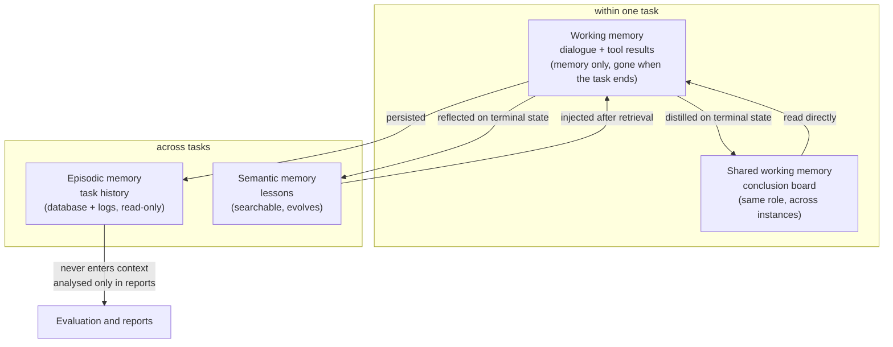
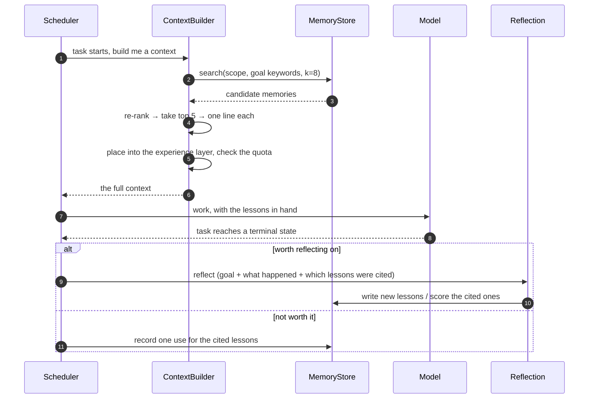

# Context and Memory System Design

[简体中文](CONTEXT-MEMORY.md) · [English](CONTEXT-MEMORY.en.md)

> These two systems are two sides of one thing:
> **context** decides what the model sees right now, **memory** decides which parts of the past
> are worth bringing into that moment.
> They share one pipeline — **retrieve → select → trim → inject**.

> The Chinese [CONTEXT-MEMORY.md](CONTEXT-MEMORY.md) is the authoritative version.
> This file is a translation.

---

## 1. Why they are designed separately

| | Context system | Memory system |
| --- | --- | --- |
| Problem it solves | Capacity: the model can only look at so much at once | Content: the past is large, what is useful? |
| Failure mode | Too much → cost runs away, budget is hit; too little → the model does not know what it is doing | Too much → retrieval noise; too little → nothing accumulates |
| Time scale | Within one task | Across tasks and conversations |
| Needs a model call | Only the last layer of compaction | Yes, when writing (reflection) |

Build the pipeline first, then the policy at each end. Reverse the order and you rework.

---

## 2. The context system

### 2.1 Modules

| Module | File | Responsibility |
| --- | --- | --- |
| **TokenBudget** | `context/tokens.py` | Estimate tokens, allocate quota, calibrate against real usage |
| **Selector** | `context/builder.py` | Decide what is admitted, and in what order it is dropped |
| **Compactor** | `context/compactor.py` | Compress history when over budget, three layers |
| **Assembler** | `context/builder.py` | Render the selected material into the final message list |
| **ConclusionBoard** | `context/board.py` | Hand-off notes between instances of one role (the fourth kind of memory, see §3) |

### 2.2 Four layers

| Layer | Contents | Changes | Suggested quota |
| --- | --- | --- | --- |
| Role | who I am, my job, my rules | fixed | 8% |
| Task | goal, acceptance criteria, upstream reports | per task | 15% |
| Experience | retrieved lessons | per task | 10% |
| Dialogue | this task's tool history | **grows only, the one that overflows** | 47% |
| Output reserve | what the model is about to generate | — | 20% |

### 2.3 The admission rules

This is the heart of the context system. Two steps: **admit by condition, then evict by budget**.

#### Step one — admission

| Material | Admitted when | Priority |
| --- | --- | --- |
| Role description | always | P0 |
| Current goal | always | P0 |
| Acceptance criteria | if declared; otherwise a single "none declared" line | P0 |
| Upstream report | only for deps in `deps` whose status is `DONE` | P1 |
| Upstream artifact paths | same, **paths only, never file contents** | P1 |
| Upstream failure reason | for deps that are `DEAD`, one line of error | P1 |
| Historical lessons | similarity ≥ threshold **and** score ≥ 0.4 | P1 |
| Role board notes | the latest 3 for the same `context_scope` | P2 |
| Recent tool results | the last 6 turns | P2 |
| Older tool results | head and tail only, 500 chars each | P3 |

#### Step two — eviction

Strictly lowest priority first; **P0 is never evicted**:

```
P3 older tool output   →  drop entirely, keep "N tool calls were made"
P2 board notes         →  3 → 2 → 1
P2 recent history      →  6 turns → 4 → 2
P1 lessons             →  5 → 3 → 1
P1 upstream reports    →  full report → artifact paths + one line
P0 role / goal         →  never dropped, but the goal is truncated to 200 chars
```

#### What never enters the context

| Material | Why |
| --- | --- |
| Another agent's raw conversation | expensive, and irrelevant to this task |
| Messages from other conversations or projects | scope isolation |
| The full execution log | read it from disk when needed, do not put it in the prompt |
| The model's own reasoning | no guidance value for the next step |
| Very long stdout | keep the tail plus the exit code |

#### Pseudocode

```python
def build(node, role):
    p0 = [system(role), brief(node)]
    p1 = dep_reports(node) + memory_hits(node)
    p2 = board(node) + recent_history(node, 6)
    p3 = older_history(node)

    budget = model_limit - reserve_output
    chosen = list(p0)                      # admitted unconditionally
    for tier in (p1, p2, p3):
        for item in tier:
            if fits(chosen, item, budget):
                chosen.append(item)
            # if it does not fit it is skipped; a high-priority item is never displaced
    return assembler.render(chosen)
```

### 2.4 Compaction in three layers

**The trigger is token count, not step count.** `deepseek-flash` has a 1M window and a 384K
maximum output, which leaves 616K for the prompt. The trigger sits at **600K** (16K of
headroom) and cuts down to **256K**.

That threshold makes compaction a **backstop, not a routine path**: a normal task of 30 steps
at 2–3K tokens per step only reaches 60–150K, nowhere near it. What actually triggers it is a
task of 100+ steps. Cost control comes from *decomposition plus prefix caching*; compaction
only handles the last wall.

The cut goes all the way in one shot (600K → 256K) rather than nibbling each step, because the
prefix cache matches on prefixes: frequent small edits invalidate everything and end up more
expensive.

When compacting, **do not start by asking the model to summarise** — that spends tokens to
solve a token problem and tends to lose the details that matter.

```
Layer 1  deterministic extraction (zero tokens, zero hallucination)
         tool results → "wrote X" / "ran Y (exit 0)" / "error: <verbatim>"
         large file output → head and tail, 500 chars each
         failed output → kept verbatim (the error is the valuable part)

Layer 2  drop the process, keep the structure
         repeated reads → keep only the last one
         successful stdout → removed entirely
         kept: which files changed, which decisions were made, which errors appeared

Layer 3  only if still over budget, ask the model to summarise (last resort)
         the input is the already-structured facts, not the raw transcript
```

The first two layers cover almost everything, and they cost nothing.

### 2.5 Token estimation and calibration

No tokenizer dependency; estimate from characters:

```
estimate(text) = CJK chars × 0.6 + other chars × 0.3
token_estimate = estimate(text) × 1.1        # 10% safety margin
```

**Calibration**: every real call returns `usage.prompt_tokens`, which is compared against the
estimate:

```
raw        = estimated / correction      # the uncalibrated estimate
target     = actual / raw                # the true bias
correction += 0.2 × (target - correction)
```

After a few tasks the error converges to within 5%. The correction factor is stored in the task
database, so it survives a restart.

### 2.6 Cost and caching

Price table (`deepseek-flash`, peak hours):

| Item | Price |
| --- | --- |
| Input (cache hit) | ¥0.04 per million tokens |
| Input (cache miss) | ¥2 per million tokens |
| Output | ¥8 per million tokens |

Two immediate conclusions:

1. **A cache hit is 50× cheaper than a miss.** A conversation is append-only and its prefix is
   stable, so most of the input in a long session is actually a cache hit; the real bill is far
   below the intuition "the context is huge, so it must be expensive".
2. **Compaction invalidates the cache.** Once history is rewritten, every prefix after that point
   misses, and that one call is billed at the miss rate. Compaction must therefore be
   *rare and deep*, not *frequent and shallow*.

This also implies a structural constraint: **stable prefix, changing tail**. The role description
and the task brief go first and never move; lessons and history are appended behind them, which
maximises the cached region.

---

## 3. The memory system

### 3.1 Four kinds of memory

| Kind | Stores | Scope | Lifetime | Where |
| --- | --- | --- | --- | --- |
| **Working** | this task's dialogue and tool results | one task | destroyed when the task ends | in memory (`AgentContext`) |
| **Shared working** | hand-off conclusions between instances of a role | project + conversation + role | follows the conversation, archived afterwards | SQLite `conclusions` |
| **Episodic** | what happened in each task (goal / steps / result) | project | long-lived, read-only | `tasks` + `events` + trace |
| **Semantic** | distilled lessons | project + role | long-lived, subject to eviction | `MemoryStore` |

How they relate:



### 3.2 How each kind is implemented

#### ① Working memory

It is the message list inside `AgentContext`. **Not persisted**, reclaimed when the task ends.
The only mechanism acting on it is compaction (§2.4).

#### ② Shared working memory (the conclusion board)

It solves one specific problem: when a role has two instances (`coder#1`, `coder#2`), the second
should not repeat the first one's dead ends.

| Item | Design |
| --- | --- |
| Key | `context_scope` = project:conversation:role |
| Written when | the task reaches a terminal state (`DONE` / `DEAD`) |
| Written what | which files changed, which key decisions were made, which errors appeared, what to tell the next one |
| Read when | a new instance of the same role starts |
| Read how much | the latest 3, about 300 tokens |
| Retention | 20 per scope, older ones pruned |
| Storage | **the orchestration layer's own SQLite**, no dependency on P3 |

**How it differs from semantic memory**: the board answers "what did we do together this time";
semantic memory answers "what should be done next time a similar situation appears".

#### ③ Episodic memory

No new storage. "Task table + event table + trace.jsonl" *is* episodic memory. It **never enters
the context**; it is read in exactly two places:

- during reflection (as source material)
- during reporting and replay (P3 / P2)

#### ④ Semantic memory

The only kind that evolves. Three moments: write, retrieve, evict.

### 3.3 Generation (write)

**Not every task is reflected on** — each reflection is an extra model call, and a simple task
that succeeded first time teaches nothing.

| State when the task ends | Reflect? | Why |
| --- | --- | --- |
| `DEAD` (failed for good) | **yes** | failure is where the real lessons are |
| `DONE` after retries (`retries > 0`) | **yes** | something went wrong and was overcome |
| `DONE` in more than 8 steps | **yes** | complexity suggests a reusable approach |
| `DONE` first try, ≤ 8 steps | no | nothing to learn, pure token waste |

How reflection runs:

```
one model call (reusing the task's role identity)
+ a submit_lesson tool (structured output; the model never writes free prose)
→ produces 0 to 2 MemoryRecord entries
→ if nothing generalises it returns zero; nothing is padded in
```

**Deduplication**: within one scope, if a new `situation` is more than 0.85 similar to an
existing one, nothing new is written; the existing record's score is bumped instead.

### 3.4 Eviction (delete)

The word "evolution" only holds up because of this layer.

```
initial value          score = 1.0

after each recall
  task succeeded       score += 0.2      (cap 3.0)
  task failed          score -= 0.3
  task never finished  unchanged

once per run (not per memory)
  not recalled recently    score *= 0.9

eviction
  score < 0.3            → soft delete (writes deleted_at, stays auditable)
  soft-deleted > 30 days  → permanent delete
```

Why soft delete: the report can say "we retired N stale lessons" instead of having them vanish
silently, and a mistaken deletion can always be undone.

### 3.5 Retrieval and ranking (read)

```
query        = a digest of the task goal + role keywords
recall       = MemoryStore.search(scope, query, k=8)
re-rank      = textual similarity × score × recency
final inject = top 3 to 5
```

Recency factor: `1 / (1 + days / 30)`, giving new lessons a mild edge without letting them
overwhelm a high-scoring older one.

> **Chinese retrieval, and why the original plan changed**: the first plan was SQLite FTS5 with
> `tokenize='trigram'`. Measured against real sentences it proved too brittle:
>
> ```
> "依赖安装"  -> hit
> "安装依赖"  -> miss   (the same words, in a different order)
> "依赖"      -> miss   (shorter than one trigram)
> ```
>
> A memory scope holds tens to a few hundred records, so no index is needed. The implementation
> uses **character-bigram overlap** computed in Python: it survives reordering, it matches
> two-character queries, and there is no index to keep in sync.

### 3.6 How memory connects to context

The full sequence:



**Writing the citation back is what makes the linkage real**: when the context injects lessons,
it records which memory ids were used (on `AgentContext`). When the task reaches a terminal
state, those records get their `uses`, `last_used_at` and score updated — whether or not
reflection runs. Without this step, scoring and eviction spin in place.

### 3.7 Fields that had to be added

`MemoryRecord` already had `score` and `uses`; decay needed two more:

| Field | Type | Purpose |
| --- | --- | --- |
| `last_used_at` | `datetime \| None` | the basis for decay |
| `deleted_at` | `datetime \| None` | the soft-delete marker |

An additive change to the contract — and the cheapest moment to make it, before P3 built the
storage.

---

## 4. Parameters (all tunable)

| Parameter | Default | Where |
| --- | --- | --- |
| Model context window | 1,000,000 | configurable |
| Model maximum output | 384,000 | configurable |
| Usable prompt ceiling | 616,000 | window − output |
| **Compaction trigger** | **600,000** | 16K of headroom |
| **Compaction target** | **256,000** | one deep cut, about 43% |
| Opening message budget | 8,000 | role + brief + lessons |
| Output reserve | 20% | TokenBudget |
| Experience quota | 10% | TokenBudget |
| Lessons injected | 3–5 | Selector |
| Lesson admission score | 0.4 | Selector |
| Reflect when retries | > 0 | Reflection |
| Reflect when steps | > 8 | Reflection |
| Lessons per reflection | 2 | Reflection |
| Dedup similarity | 0.85 | Memory |
| Decay factor | 0.9 / run | Evolution |
| Eviction threshold | 0.3 | Evolution |
| Board entries kept | 20 / scope | Board |

---

## 5. Implementation status

| Component | Status |
| --- | --- |
| `context/tokens.py` | ✅ estimator + EMA calibration, correction stored in `meta` |
| `context/compactor.py` | ✅ three layers, whole turns, pinned prefix untouched |
| `context/builder.py` | ✅ four layers + admission rules + opening budget |
| `context/board.py` | ✅ conclusion board + `conclusions` table |
| `memory/store.py` | ✅ reference implementation (SQLite + character bigrams) |
| `memory/reflection.py` | ✅ trigger policy + `submit_lesson` |
| `memory/evolution.py` | ✅ scoring / decay / eviction |
| `memory/retrieval.py` | ✅ query construction + re-ranking |

Regression suites: `tests/test_tokens.py`, `test_compactor.py`, `test_context_builder.py`,
`test_board.py`, `test_memory.py`, `test_memory_loop.py`.

## 6. Build order (completed)

```
1. context/tokens.py      estimation + calibration
2. context/compactor.py   three-layer compaction
3. context/builder.py     four layers + admission + eviction
4. context/board.py       conclusion board (with its SQLite table)
5. memory/store.py        reference implementation: SQLite + bigram retrieval
6. memory/reflection.py   trigger policy + submit_lesson
7. memory/evolution.py    scoring / decay / eviction
8. memory/retrieval.py    query construction + ranking
```

The first four depend on nobody; step five is P3's territory, so a reference implementation was
written first for them to replace.

## 7. Risks and mitigations

| Risk | Mitigation |
| --- | --- |
| Token estimates drift | calibrate continuously against real usage, keep a 10% margin |
| Compaction loses something critical | layer 2 only drops successful output; error text and artifact paths are always kept |
| Reflection produces junk lessons | scoring and eviction are the backstop; a bad lesson that keeps preceding failures drops out quickly |
| Poor Chinese recall | character-bigram overlap, measured to be more robust than trigram (tolerates reordering) |
