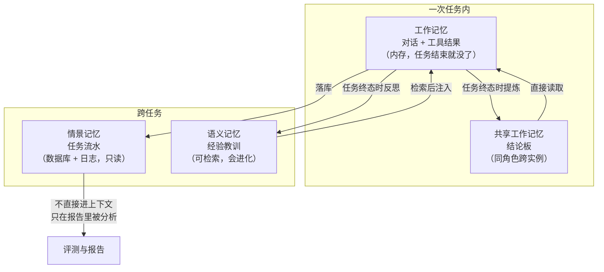
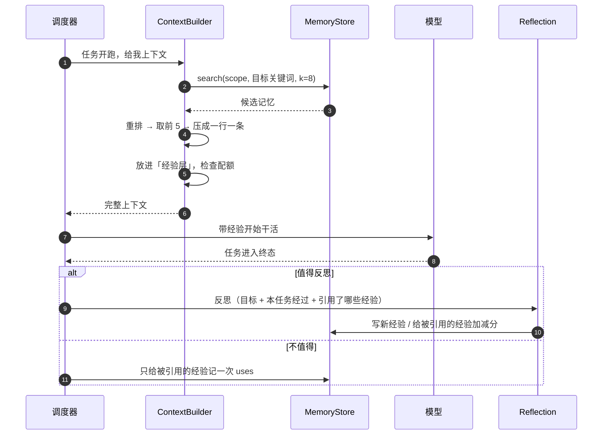

# 上下文与记忆系统设计

[简体中文](CONTEXT-MEMORY.md) · [English](CONTEXT-MEMORY.en.md)

> 这两个系统是一件事的两面：
> **上下文**决定「这一刻给模型看什么」，**记忆**决定「过去哪些东西值得拿到这一刻来看」。
> 它们共用同一条管道 —— **检索 → 选择 → 裁剪 → 注入**。

---

## 1. 为什么要分开设计

| | 上下文系统 | 记忆系统 |
| --- | --- | --- |
| 解决的问题 | 容量：模型一次只能看这么多 | 内容：过去的东西太多，哪些有用 |
| 失败模式 | 塞太多 → 成本失控、撞预算；塞太少 → 模型不知道在干嘛 | 记太多 → 检索噪声；记太少 → 不会积累 |
| 时间尺度 | 一次任务之内 | 跨任务、跨对话 |
| 是否必须调模型 | 压缩的最后一层才需要 | 写入时需要（反思） |

先有管道，再定两端的策略。顺序反了会返工。

---

## 2. 上下文系统

### 2.1 模块组成

| 模块 | 文件 | 职责 |
| --- | --- | --- |
| **TokenBudget** | `context/tokens.py` | 估算 token、分配配额、用真实用量反向校准 |
| **Selector** | `context/builder.py` | 决定哪些材料进入上下文、按什么顺序淘汰 |
| **Compactor** | `context/compactor.py` | 超预算时压缩历史，三层递进 |
| **Assembler** | `context/builder.py` | 把选中的材料拼成最终消息列表 |
| **ConclusionBoard** | `context/board.py` | 同角色实例之间的交接信息（记忆的第四类，见 §3）|

### 2.2 上下文分四层

| 层 | 内容 | 变化频率 | 建议配额 |
| --- | --- | --- | --- |
| 角色层 | 我是谁、职责、操作规则 | 固定 | 8% |
| 任务层 | 目标、验收项、上游报告 | 每层任务不同 | 15% |
| 经验层 | 检索到的历史教训 | 每次任务不同 | 10% |
| 对话层 | 本任务的工具调用历史 | **只增不减，唯一会爆的** | 47% |
| 输出预留 | 模型这次要生成的 | — | 20% |

### 2.3 判断「加不加入」的完整规则

这是上下文系统的核心。分两步：**先按条件准入，再按预算淘汰**。

#### 第一步：准入（能不能进来）

| 材料 | 准入条件 | 优先级 |
| --- | --- | --- |
| 角色说明 | 永远加入 | P0 |
| 当前任务目标 | 永远加入 | P0 |
| 验收项 | 有则加入；无则写"未声明"一行 | P0 |
| 上游任务报告 | 仅 `deps` 中且状态为 `DONE` 的 | P1 |
| 上游任务产物路径 | 同上，**只列路径不贴内容** | P1 |
| 上游失败原因 | 状态为 `DEAD` 的，只加一行错误摘要 | P1 |
| 历史经验 | 相似度 ≥ 阈值 **且** 分数 ≥ 0.4 | P1 |
| 同角色结论板 | 同 `context_scope` 的最近 3 条 | P2 |
| 本任务近期工具结果 | 最近 6 轮 | P2 |
| 本任务早期工具结果 | 只保留头尾各 500 字符 | P3 |

#### 第二步：淘汰（预算不够先砍谁）

淘汰顺序严格从低到高，**P0 永不淘汰**：

```
P3 早期工具输出  →  整段丢弃，只留 "已执行过 N 次工具调用"
P2 结论板        →  3 条 → 2 条 → 1 条
P2 近期历史      →  6 轮 → 4 轮 → 2 轮
P1 经验          →  5 条 → 3 条 → 1 条
P1 上游报告      →  完整报告 → 只留产物路径 + 一行结论
P0 角色/目标     →  不淘汰，但把目标截断到 200 字
```

#### 明确不进上下文的东西

| 材料 | 原因 |
| --- | --- |
| 其他 Agent 的原始对话 | token 大户，且与本任务无关 |
| 其他对话/其他项目的消息 | 作用域隔离 |
| 完整执行日志 | 需要时查文件，不塞进 prompt |
| 模型的思考过程 | 对下一步没有指导价值 |
| 超长的 stdout | 只留尾部 + 退出码 |

#### 伪代码

```python
def build(node, role):
    p0 = [system(role), brief(node)]
    p1 = dep_reports(node) + memory_hits(node)
    p2 = board(node) + recent_history(node, 6)
    p3 = older_history(node)

    budget = model_limit - reserve_output
    chosen = list(p0)                      # 无条件进入
    for tier in (p1, p2, p3):
        for item in tier:
            if fits(chosen, item, budget):
                chosen.append(item)
            # 放不下就直接跳过，不挤掉高优先级
    return assembler.render(chosen)
```

### 2.4 压缩：三层递进

**触发依据是 token 量，不是步数。** `deepseek-flash` 的窗口是 1M、最大输出 384K，
所以可用 prompt 上限是 616K；触发点定在 **600K**（留 16K 余量），砍到 **256K**。

这个阈值意味着压缩是**兜底护栏，不是日常路径**：正常任务 30 步 × 每步 2–3K token，
也就 60–150K，根本碰不到。真正触发的是 100+ 步的超长任务。成本控制靠的是
「任务分解 + 前缀缓存」，压缩只负责最后那道坎。

一刀砍到位（600K → 256K）而不是每步微调，是因为前缀缓存按前缀命中：频繁小改会让
缓存全部失效，反而更贵。

压缩时**不要一上来就让模型总结** —— 那是花 token 解决 token 问题，还容易丢掉关键信息。

```
第 1 层  确定性提取（零 token，零幻觉）
        工具调用结果 → "写了 X" / "跑了 Y（退出码 0）" / "报错：<原文>"
        大文件输出   → 只留头尾各 500 字符
        失败的输出   → 原样保留（错误信息最有价值）

第 2 层  丢过程、保结构
        重复的 read 结果只留最后一次
        成功的 stdout 整段删除
        保留：改了哪些文件、做了什么决策、报了什么错

第 3 层  仍然超限，才调模型摘要（最后手段）
        输入是被压缩过的结构化事实，不是原始对话
```

前两层能解决绝大多数情况，而且不花一分钱。

### 2.5 token 估算与校准

不引入分词器依赖，用字符估算：

```
estimate(text) = CJK字符数 × 0.6 + 其他字符数 × 0.3
token_estimate = estimate(text) × 1.1        # 10% 安全边距
```

**校准机制**：每次真实调用返回 `usage.prompt_tokens`，与估算值比较：

```
raw        = estimated / correction      # 去掉校准后的原始估算
target     = actual / raw                # 真实偏差
correction += 0.2 × (target - correction)
```

跑几个任务后误差能收敛到 5% 以内。校准系数存在任务库里，重启不丢。

### 2.6 成本与缓存

价格表（`deepseek-flash`，高峰时段）：

| 项 | 单价 |
| --- | --- |
| 输入（缓存命中） | 0.04 元 / 百万 token |
| 输入（缓存未命中） | 2 元 / 百万 token |
| 输出 | 8 元 / 百万 token |

两个直接结论：

1. **命中与未命中差 50 倍。** 对话是追加式的，前缀稳定，所以一个长会话的绝大部分
   输入其实是缓存命中，实际账单远低于"上下文有多大"的直觉。
2. **压缩会破坏缓存。** 一旦重写历史，之后所有前缀都失效，那一次要按未命中价重读。
   所以压缩策略必须是「少次大砍」，而不是「每步微调」。

由此还推出一条上下文结构约束：**稳定前缀 + 变化尾部**。
角色说明和任务简报放在最前面且永不变动，经验和历史追加在后面，让缓存命中区最大化。

---

## 3. 记忆系统

### 3.1 分四类记忆

| 类型 | 存什么 | 作用域 | 生命周期 | 实现位置 |
| --- | --- | --- | --- | --- |
| **工作记忆** Working | 当前任务的对话与工具结果 | 单次任务 | 任务结束即销毁 | 内存（`AgentContext`）|
| **共享工作记忆** Shared | 同角色实例之间的交接结论 | 项目 + 对话 + 角色 | 跟对话，结束后归档 | SQLite `conclusions` 表 |
| **情景记忆** Episodic | 每个任务的经过（目标/步骤/结果） | 项目 | 长期，只读 | `tasks` + `events` + trace |
| **语义记忆** Semantic | 提炼出的经验教训 | 项目 + 角色 | 长期，会淘汰 | `MemoryStore` |

四类的关系：



### 3.2 各类记忆的实现

#### ① 工作记忆

就是 `AgentContext` 里的消息列表。**不落盘**，任务结束即回收。
唯一的机制是 §2.4 的压缩。

#### ② 共享工作记忆（结论板）

解决一个具体问题：同一个角色开了两个实例（`coder#1`、`coder#2`），
第二个不该重复第一个试过的弯路。

| 项 | 设计 |
| --- | --- |
| 键 | `context_scope` = 项目:对话:角色 |
| 写入时机 | 任务进入终态（`DONE` / `DEAD`）|
| 写入内容 | 改了哪些文件、做了什么关键决策、报了什么错、给下游留什么话 |
| 读取时机 | 同角色新实例启动时 |
| 读取量 | 最近 3 条，约 300 token |
| 保留策略 | 每个 scope 保留最近 20 条，更早的归档 |
| 存储 | **编排层自己的 SQLite**，不经过 P3，无耦合 |

**和语义记忆的区别**：结论板回答「这次我们一起做了什么」，语义记忆回答「下次遇到类似情况该怎么做」。

#### ③ 情景记忆

不新增存储。「任务表 + 事件表 + trace.jsonl」本身就是情景记忆。
它**不进入上下文**，只在两个地方被读：

- 反思时（作为素材）
- 报告与回放时（P3 / P2）

#### ④ 语义记忆

唯一的「会进化」的一类。三个时刻：写、取、淘汰。

### 3.3 生成机制（写）

**不是每个任务都反思** —— 每次反思是一次额外的模型调用，成功的简单任务没什么可学的。

| 任务结束时的状态 | 是否反思 | 理由 |
| --- | --- | --- |
| `DEAD`（彻底失败） | **是** | 失败才是真经验 |
| `DONE` 且有重试（`retries > 0`） | **是** | 踩过坑才做出来 |
| `DONE` 且步数 > 8 | **是** | 复杂度说明有可复用的做法 |
| `DONE` 且一次过、步数 ≤ 8 | 否 | 没有可学的，纯浪费 token |

反思的执行方式：

```
一次模型调用（复用任务的角色身份）
+ submit_lesson 工具（结构化输出，不让模型写自由文本）
→ 产出 0 ~ 2 条 MemoryRecord
→ 没有值得记的就返回 0 条，不强行凑
```

**去重**：同作用域下，如果新条目的 `situation` 与已有条目相似度 > 0.85，
不新增，而是把已有条目的分数 +0.1 并更新 `last_used_at`。

### 3.4 淘汰机制（删）

「进化」这个词要靠这一层才站得住。

```
初始值            score = 1.0

每次被引用之后
  任务成功         score += 0.2      （上限 3.0）
  任务失败         score -= 0.3
  任务未终结        不变

每个反思周期（不是每条记忆）执行一次衰减
  过去 N 个任务内未被引用   score ×= 0.9

淘汰
  score < 0.3            → 软删除（写 deleted_at，保留可审计）
  软删除超过 30 天        → 物理删除
```

软删除的意义：报告里可以说"我们淘汰了 N 条失效经验"，而不是悄悄消失。
同时任何时候都能把误删的恢复回来。

### 3.5 检索与排序（取）

```
查询串    = 任务目标的摘要 + 角色关键词
候选召回  = MemoryStore.search(scope, query, k=8)
二次排序  = 文本相似度 × score × 时效因子
最终注入  = 取前 3 ~ 5 条
```

时效因子：`1 / (1 + 天数 / 30)`，让新经验有轻微优势，但不会压倒高分的旧经验。

> **中文检索的技术细节（实测后改过方案）**：原本打算用 SQLite FTS5 的 `tokenize='trigram'`，
> 但实测下来它太脆：
>
> ```
> "依赖安装"  -> 命中
> "安装依赖"  -> 未命中   （同样的词，换了顺序）
> "依赖"      -> 未命中   （短于一个 trigram）
> ```
>
> 记忆库每个作用域只有几十到几百条，用不着索引。改成**字符二元组重叠**（Python 里算），
> 语序不同也能命中，两字查询也能命中，而且没有索引需要维护。

### 3.6 与上下文的联动

完整的时序：



**引用回写是联动的关键**：
上下文在注入经验时，要把「这次引用了哪几条记忆」记下来（存在 `AgentContext` 的元数据里）。
任务到终态时，无论是否反思，都要回来更新这几条的 `uses`、`last_used_at` 和分数。
没有这一步，打分和淘汰就是空转。

### 3.7 需要新增的字段

`MemoryRecord` 目前有 `score` 和 `uses`，做衰减还缺两样：

| 字段 | 类型 | 用途 |
| --- | --- | --- |
| `last_used_at` | `datetime \| None` | 衰减判定的依据 |
| `deleted_at` | `datetime \| None` | 软删除标记 |

这是对契约的增量修改，趁 P3 还没实现存储，现在改成本最低。

---

## 4. 参数总表（可调）

| 参数 | 默认值 | 位置 |
| --- | --- | --- |
| 模型上下文窗口 | 1,000,000 | 可配置 |
| 模型最大输出 | 384,000 | 可配置 |
| 可用 prompt 上限 | 616,000 | 窗口 − 输出 |
| **压缩触发** | **600,000** | 留 16K 余量 |
| **压缩目标** | **256,000** | 一次砍到位，约 43% |
| 开场消息上限 | 8,000 | 角色 + 简报 + 经验 |
| 输出预留 | 20% | TokenBudget |
| 经验层配额 | 10% | TokenBudget |
| 注入经验条数 | 3–5 | Selector |
| 经验准入分数 | 0.4 | Selector |
| 反思触发：重试次数 | > 0 | Reflection |
| 反思触发：步数 | > 8 | Reflection |
| 单次反思产出上限 | 2 条 | Reflection |
| 去重相似度阈值 | 0.85 | Memory |
| 衰减系数 | 0.9 / 周期 | Evolution |
| 淘汰阈值 | 0.3 | Evolution |
| 结论板保留条数 | 20 / scope | Board |

---

## 5. 实现状态

| 组件 | 状态 |
| --- | --- |
| `context/tokens.py` | ✅ 估算 + EMA 校准，系数存 `meta` 表 |
| `context/compactor.py` | ✅ 三层，整轮粒度，pinned 前缀不动 |
| `context/builder.py` | ✅ 四层 + 准入规则 + 开场预算 |
| `context/board.py` | ✅ 结论板 + `conclusions` 表 |
| `memory/store.py` | ✅ 参考实现（SQLite + 字符二元组检索） |
| `memory/reflection.py` | ✅ 触发策略 + `submit_lesson` |
| `memory/evolution.py` | ✅ 打分 / 衰减 / 淘汰 |
| `memory/retrieval.py` | ✅ 查询构造 + 重排 |

回归测试：`tests/test_tokens.py`、`test_compactor.py`、`test_context_builder.py`、
`test_board.py`、`test_memory.py`、`test_memory_loop.py`。

## 6. 实施顺序（已完成）

```
1. context/tokens.py      估算 + 校准
2. context/compactor.py   三层压缩
3. context/builder.py     改造：四层 + 准入 + 淘汰
4. context/board.py       结论板（含 SQLite 表）
5. memory/store.py        参考实现：SQLite + 字符二元组检索
6. memory/reflection.py   反思触发 + submit_lesson
7. memory/evolution.py    打分 / 衰减 / 淘汰
8. memory/retrieval.py    查询构造 + 排序
```

前四步不依赖任何人；第 5 步是 P3 的地盘，先写参考实现让他替换。

## 7. 风险与对策

| 风险 | 对策 |
| --- | --- |
| token 估算不准 | 用真实 usage 持续校准，安全边距 10% |
| 压缩丢关键信息 | 第 2 层只丢"成功的输出"，错误信息永远保留；产物路径永远保留 |
| 反思产出垃圾经验 | 靠打分与淘汰兜底；新经验默认分数不高，被引用失败会快速掉下去 |
| 中文检索召回差 | 用字符二元组重叠，实测比 trigram 稳健（能容忍语序） |
