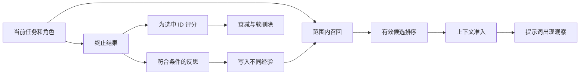

# 上下文与记忆设计

[简体中文](CONTEXT-MEMORY.md) · [English](CONTEXT-MEMORY.en.md)

上下文决定模型在本次尝试中能看到什么，长期记忆保存可能帮助后续任务的经验。人类澄清属于单独的事实记录，应在委派和重试后恢复，不得转化成可重复使用的工具授权。

本文描述当前代码及配置默认值。新恢复、观察和证据采集功能仍待回归；设计本身不构成性能收益或模型厂商容量的证明。

## 组件与范围

| 组件 | 实现 | 范围和用途 |
| --- | --- | --- |
| 消息列表 | `context/builder.py: AgentContext` | 本次尝试的开头与对话 |
| 内容准入 | `ContextBuilder`、`eval/team.py: TeamContextBuilder` | 必需要求与受限的可选证据 |
| 压缩 | `context/compactor.py` | 缩短工具输出、删除完整旧轮次 |
| Token 估算 | `context/tokens.py` | 按字符估算，并用真实用量校准 |
| 人类问答记录 | `human_history.py`、`orchestrator/state.py` | project/conversation/task/role 内的原始问答 |
| 结论板 | `context/board.py` | project/conversation/role 内的近期交接 |
| 长期经验 | `memory/store.py` | project/role 内持久记录 |
| 检索 | `memory/retrieval.py` | 范围过滤与候选排序 |
| 反思 | `memory/reflection.py` | 从符合条件的终止任务提取结构化经验 |
| 演化 | `memory/evolution.py` | 评分、衰减与软删除 |

正式团队成员使用稳定 role ID 与私有目录，project:role 表示连续任务中的同一逻辑 Agent。不同场景/运行使用独立数据库。通用 Engine 的 `role@task` 实例仍按 project-role 共享长期记忆。

## 开头内容准入

system 消息与 user 任务简报在压缩时固定保留。当前角色说明、完整当前目标、全部验收字段以及已验证的同任务原答复均属于必需内容。

可选输入包括显式依赖报告、检索经验、结论板及正式适配器的前次协作索引。通用 builder 减少依赖、经验和结论条目；正式 builder 逐级缩短历史、依赖、结论和经验的预览。

开头上限为 `opening_budget_tokens` 与 `context_window - max_output_tokens` 的较小值。先检查必需内容；无法容纳时在模型调用前抛出 `ContextAdmissionError`，不再通过静默截断当前目标挤出空间。

正式适配器将完整辅助输入保存在各角色私有的 `.evaluation/context/<digest-prefix>.json` 中。文件名取 32 位十六进制前缀，引用保留完整 SHA-256，同名不同内容会被拒绝。这些文件和历史对话副本属于框架证据，不是新指令或项目交付物。

### 人类澄清恢复

TaskRepo 记录原问题/答复、范围、Agent ID、request ID 和时间戳。校验拒绝范围或 ID 不符、空答、冲突答复，以及已有提问事件却缺少可恢复问答的情况。

同任务重新进入执行器时，原答复被恢复到固定开头，不回放缺少配对的模型 tool call。运行中收到新答案后也会刷新固定开头，避免后续压缩再次丢失。

`ResumableHumanIO` 是可选能力。控制台/文件实现可以按原范围、ID 和正文继续问题。恢复已消费答复不会再次执行回调；尚未消费答复的回调如会改变外部状态，必须按 request ID 实现幂等。不支持恢复时明确失败。

澄清历史不会批准工具操作、创建质量通过结果、证明文字一定由真人手工输入，也不会自动回答未决问题。操作审批继续经过 Gate。

## 对话压缩

压缩由估算提示词大小触发，不按固定步数触发。处理范围位于固定开头之后：

1. 确定性缩短长工具输出，保留开头、结尾和诊断行。
2. 按完整轮次删除较早对话，至少保留四个近期轮次；assistant 的 tool call 与相应结果保持配对。
3. 仅在显式启用并提供 summarizer 时调用摘要器。

`allow_llm_summary` 默认关闭。如果固定内容和近期对话很大，压缩后仍可能超过目标；执行器检查上限并明确失败，不能把“执行过压缩”当作“已压至目标”。

运行中的人类 steering 通过 Channel 进入对话，与问题记录、工具审批分别处理。

## Token 估算与配置

估算器按每个 CJK 字符约 0.6、其他字符约 0.3 计量，加入 1.1 余量及消息/tool call 开销。`TokenBudget.observe` 用真实输入用量通过 EMA（alpha 0.2）调整校正系数，范围限制为 0.5–2.0；Engine 持久化该系数。

这是启发式估算，不是 tokenizer，也没有保证误差上限。提供方未返回的用量保持未知。上下文/输出限制必须适合实际课程模型，不预设价格或账单节省。

当前 `ContextPolicy` 默认值如下：

| 配置 | 默认值 |
| --- | ---: |
| 上下文窗口 | 1,000,000 |
| 最大输出预留 | 384,000 |
| 压缩触发 / 目标 | 600,000 / 256,000 |
| 开头预算 | 8,000 |
| 召回 / 最终候选上限 | 8 / 5 |
| 最低经验分数 | 0.4 |
| 近期结论板条数 | 3 |
| 反思步数阈值 | 超过 8 步 |
| 单次反思经验上限 | 2 |
| 衰减系数 / 淘汰阈值 | 0.9 / 0.3 |

这些是仓库配置值，不是模型厂商当前规格的声明。模型配置见[安装说明](SETUP.md)。

## 长期记忆生命周期

### 检索与排序

查询由任务目标和角色名构成，最多 200 个字符。SQLite 按 project:role 和有效记录过滤，使用字符 bigram 重叠做文本召回。Retriever 排除已删除或低分记录，依据召回顺序、分数和创建时间新近度排序，最多返回 `memory_top_k` 条。

候选可能在准入阶段被删减，正式适配器也可能缩短经验预览。检索到某个 ID 并不证明全文已经进入提示词。

### 反思与评分

终止为 `DEAD`、发生过重试或超过步数阈值的任务可以反思。模型提交结构化 `submit_lesson`，数量从零到配置上限。空或无效结果不会被补成虚构经验；确定性 trigram 比较用于跳过近似重复文本。

被选择/引用的 ID 在 `DONE` 时增加 0.2，失败时减少 0.3，存储层限制分数边界。这是框架归因策略，不证明模型实际依赖该经验推理。反思和维护失败会记录，但不把终止任务变成新的任务失败。

每轮结束后，未使用的旧经验按配置衰减；本轮新记录免于衰减。低于阈值的记录软删除，默认存储还可永久删除超过 30 天的软删除记录。

### 结论板

结论板为终止任务写入简短记录，每个 project:conversation:role 最多保留 20 条，并读取配置的近期子集。关闭长期经验记忆不会关闭结论板，消融报告必须说明这一边界。

## 观察和评测

| 事件 | 记录的事实 | 不能证明什么 |
| --- | --- | --- |
| `memory_retrieved` | 返回的 ID 与范围 | 准入或实际使用 |
| `memory_context_selected` | 上下文选择的候选 ID | 每次后续提示词都含有完整文本 |
| `memory_prompt_observed` | 实际 system 消息中唯一单行经验的精确匹配 | 推理使用、奖励或因果收益 |

重复/重叠身份、截断和多行经验在提示词出现观察中保持歧义或未知。`uses` 与 `score` 反映策略更新，不是独立的学习效果测量。

正式任务在 Engine 运行结束后保存各角色有效记忆元数据及原观察事件，元数据中的经验内容以哈希表示。它不是该任务新增记录总数、删除总数或开关对照实验。

离线报告、分析和回放使用已保存的阶段证据与上下文归档，不读取后来可变的 live memory 数据库重建旧阶段。没有遥测表示未知，不表示零检索或未使用。连续 Task 1/Task 2 是不同且依赖的目标，不能单凭两次结果宣称统计或因果改进。

测量边界见[指标说明](metrics.zh-CN.md)，消费接口见[共享接口](INTERFACES.md)。