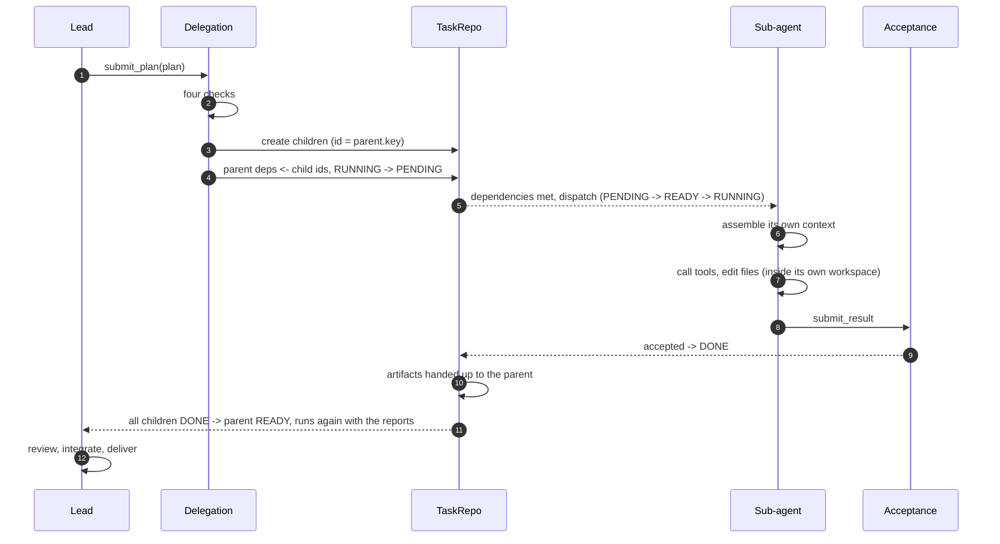

# Sub-agents

[简体中文](SUBAGENTS.md) · [English](SUBAGENTS.en.md)

> A sub-agent is not "a model process that writes code". It is three things together:
> **a task record + its own context + its own workspace**.
>
> Every agent runs on the same event loop. Isolation comes from those three, not from processes.

> The Chinese [SUBAGENTS.md](SUBAGENTS.md) is the authoritative version.
> This file is a translation.

---

## 1. Lifecycle



In one sentence: **the lead decides and verifies; a sub-agent finishes one thing inside its own walls.**
The only channel between them is the task record.

---

## 2. Creation

### 2.1 Who decides

The lead. It calls `submit_plan`, passing the plan as a **tool argument** rather than free text;
the argument shape is generated from the `Plan` pydantic model, so there is no prose to parse.

### 2.2 What a plan contains

```python
Plan:
  reasoning: str                 # why this split, for humans
  roles: list[RoleDraft]         # roles needed by this plan
  subtasks: list[SubtaskSpec]    # at most 6

RoleDraft:
  name / title / description     # who it is, what it does
  tools: list[str]               # what it may use
  reason: str                    # why existing roles do not fit (required)

SubtaskSpec:
  key: str                       # local id inside the plan
  goal: str                      # self-contained objective
  role: str                      # which role
  deps: list[str]                # which siblings it waits for
  acceptance: list[Acceptance]   # machine-checkable criteria
```

### 2.3 The four checks (`Delegation.validate`)

| Check | Rejected when | Why |
| --- | --- | --- |
| Graph | a dependency cycle, or a dependency on an unknown key | a cycle waits forever |
| Size and depth | more than 6 subtasks, deeper than 2 | stops an uncontrolled tree |
| Role availability | neither an existing role nor declared in `roles` | otherwise nobody can do the task |
| Tool existence | a tool name that is not registered | otherwise it fails halfway through |
| Lead not delegable | a subtask naming `planner` | that role owns the whole task |

A failed check is not a crash: the `DelegationError` text goes back to the model, which rewrites the
plan.

### 2.4 Persistence

| Action | Result |
| --- | --- |
| Roles | written to the `roles` table at **project** scope, reusable next time (look before create) |
| Subtasks | written to `tasks`, `id = parent.id + "." + key` |
| Parent | `deps` rewritten to the child ids, status `RUNNING → PENDING` |
| Audit | both actions leave an event row |

A parent becoming `PENDING` does not mean "stuck"; it means **"handed off, waiting for them"**. Its
dependencies are now the children, and it returns to `READY` once they are all `DONE`.

### 2.5 Instantiation

An instance is created only when the task is dispatched:

```
agent_id = f"{role.name}@{task.id}"          e.g. python_dev@t1.code
workspace = runs/<project>/<conversation>/<agent_id>/    one directory per instance
```

Two instances of the same role **share the memory namespace but not the workspace**: lessons carry
over, files do not.

---

## 3. Context: what a sub-agent can see

### 3.1 Four layers, with strict admission

| Layer | Contents | Source |
| --- | --- | --- |
| Role | a two-line brief plus the framework rules | `RoleSpec` + `prompts.FRAMEWORK_RULES` |
| Task | goal, acceptance criteria, upstream reports | its own `TaskNode` plus its dependencies |
| Experience | 3–5 retrieved lessons | `Retriever.fetch` |
| Dialogue | its own tool history | accumulated at runtime |

**Only `DONE` dependencies contribute a report.** A `DEAD` dependency contributes one line of error,
never its whole transcript.

### 3.2 What it cannot see

| Not visible | Why |
| --- | --- |
| the lead's conversation | a sub-agent has no business knowing what the lead is weighing |
| sibling conversations | they may be running in parallel and would only interfere |
| other conversations or projects | scope isolation |
| the full execution log | read it from disk when needed; it does not belong in a prompt |

That is why the lead must write self-contained goals — the lead prompt says so explicitly.

### 3.3 Opening budget: 8k

The opening messages (role + brief + lessons) are capped at 8k tokens; over budget, cuts happen in a
fixed order:

```
upstream reports 6→3→1 → lessons 5→3→1 → goal truncated to 200 chars
```

The role description is never cut: a model that forgets what it is doing is worse than one that
misses a dependency report.

### 3.4 Runtime compaction: 600k → 256k

A sub-task can legitimately run for a hundred steps. Compaction is checked **before every model
call**:

| Item | Value |
| --- | --- |
| Trigger | estimated tokens > 600,000 |
| Target | cut to 256,000 |
| Granularity | **whole turns** (assistant + all its tool results), never split |
| Pinned prefix | the first 2 messages (role + brief), never compacted |

Three layers: deterministic shrinking of tool output first, then dropping the oldest whole turns,
then (off by default) asking the model to summarise.

Why 600k: `deepseek-flash` has a 1M window and a 384K maximum output, leaving 616K for the prompt;
the trigger keeps 16K of headroom.

---

## 4. Memory: how a sub-agent accumulates and reuses

| Kind | Scope | Written by | Read by | Lifetime |
| --- | --- | --- | --- | --- |
| Working | one task | the runtime | itself | destroyed when the task ends |
| Shared working (board) | project + conversation + role | the framework at terminal state | new instances of the same role | follows the conversation |
| Episodic | project | task table + event table + trace | reflection, reports | long-lived, read-only |
| Semantic | project + role | reflection | injected after retrieval | long-lived, subject to eviction |

**The board** exists so that a second instance of a role does not repeat the first one's dead ends.
An entry is short: which files changed, which decision was made, what to tell the next one.

**Semantic memory** is written only where it pays: on failure, after retries, or above eight steps.
Each entry is scored — +0.2 when a recall precedes success, −0.3 when it precedes another failure,
×0.9 when it goes unused, soft-deleted below 0.3.

---

## 5. Communication: lead ↔ sub-agent

### 5.1 Downward: how the work is described

There is exactly one path — `SubtaskSpec`. The lead can pass four things: goal, acceptance criteria,
role and dependencies. **There is no "one more thing" channel**, which is precisely why the goal has
to be self-contained.

### 5.2 Upward: the `submit_result` hand-off

When done, the sub-agent calls `submit_result`:

```python
TaskResult:
  summary: str        # one-line conclusion
  files: list[str]    # what changed
  notes: str          # what the next person needs to know
  blockers: list[str] # what is still unresolved
```

The framework stores it as JSON; the parent renders the fields, capped at **3k characters** (it used
to be 800, which routinely cut off the point).

If the agent never calls the tool and just replies with text, the framework wraps it as
`TaskResult(summary=text)`. The old behaviour still works, it is just less dense.

### 5.3 Why not a group chat

A sub-agent **cannot approach the lead mid-run** today; it can only ask the human (`ask_human`).
A real team would let it ask its manager, but that needs a return channel, waking the parent, and
handling "the parent is waiting on children and receives a message from one" — a structural change.

It **does not affect the other three modules** (no port is touched), so it can be added at any time.
It simply is not being done now.

### 5.4 What happens on failure

| Situation | Behaviour |
| --- | --- |
| Acceptance fails | `FAILED` → retry (up to 2) → `DEAD` if it keeps failing |
| A child is `DEAD` | the **parent is woken** (`PENDING → READY`) and runs again with the failure in view |
| The parent re-dispatches | new children carry a round prefix `t1.r1.a`, so ids cannot collide |
| Wake-up budget exhausted | each wake-up is counted; past 2 the parent goes `DEAD` |

When woken, the parent's brief contains the failed child's line:

```
### t1.a — python_dev — FAILED
reason: tests kept failing
```

The lead prompt already says what to do: **do not forward the failure unchanged; create a fresh
specialist, hand it the current state and the error.** After two consecutive failures, state it
plainly and lay out the options.

---

## 6. Role evolution

Roles are invented by the model, and may also be changed by it -- but not without a
human agreeing.

### Trigger

Every three finished tasks (configurable), the framework asks the model once, **after
a run has ended**: is there a role description whose wording would have changed an
outcome?

It runs at the end rather than between tasks so it never blocks work in flight.

### Proposal

The model submits a structured proposal through the `submit_revision` tool:

```python
RoleRevisionDraft:
  role: str                   # empty = nothing worth changing
  proposed_description: str   # the new description, capped at 800 chars
  reason: str                 # why this would have changed an outcome
  evidence: list[str]         # which tasks support it
```

The model is told plainly: **no cosmetic rewording**; if nothing would have changed a
result, submit an empty proposal.

### Approval

It goes through `HumanIO.ask(kind="review")`, and the card carries the current
description, the proposed one and the reason side by side.

| The human answers | Result |
| --- | --- |
| approve | the role goes to the next version and its description changes; the next prompt for that role differs |
| reject with a note | the note feeds the next proposal, up to three rounds |
| reject with nothing | the cycle ends; there is nothing to iterate on |

### Record

Every proposal and decision lands in the `role_revisions` table and the trace, so the
report can show a role's evolution.

## 7. Parameters

| Parameter | Default | Where |
| --- | --- | --- |
| Max subtasks per plan | 6 | `MAX_SUBTASKS` |
| Max decomposition depth | 2 | `MAX_DEPTH` |
| Max wake-ups per parent | 2 | `MAX_WAKEUPS` |
| Max hand-off characters | 3000 | `MAX_RESULT_CHARS` |
| Opening message budget | 8000 tokens | `ContextPolicy.opening_budget_tokens` |
| Compaction trigger / target | 600k / 256k tokens | `ContextPolicy` |
| Lessons injected | 3–5 | `ContextPolicy.memory_top_k` |
| Board entries read | 3 | `ContextPolicy.board_entries` |
| Role review interval | 3 tasks | `Settings.role_review_every` |
| Role review rounds | 3 | `Settings.role_review_max_rounds` |

---

## 8. Known limits

| Limit | Impact | Note |
| --- | --- | --- |
| A sub-agent cannot approach the lead mid-run | when stuck it can only ask the human, or push on alone | no external coupling; can be added later |
| Tool grants are only checked for existence | a sub-agent can be granted `shell` and the like | every dangerous call still needs human approval, but two gates became one |
| Role descriptions age | a role invented for task one is still in use at task ten | exactly what role revision is meant to fix |
| A woken parent sees one line of the child's failure | not the child's transcript | the trace has the detail |
| Scripted humans auto-approve reviews in batch runs | reusing one database drifts the descriptions | not an issue when each run gets a fresh database |
