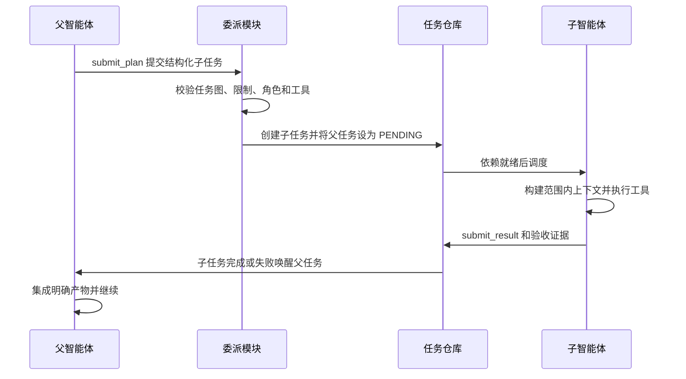

# 子智能体与连续团队

[简体中文](SUBAGENTS.md) · [English](SUBAGENTS.en.md)

一个运行中的智能体由所分配的任务、自己的上下文和私有工作区组成。通用引擎按需要创建角色；正式老师会话复用每组原始四名成员。下面的机制均有源码实现，当前开发版本新增恢复、trace 层级和清理回归尚未执行。

## 委派生命周期



计划包含拆分理由、角色草案和子任务。每个子任务指定 key、自包含目标、角色、兄弟依赖和机器验收条件。校验拒绝重复 key、未知/成环依赖、超出深度或子任务数量、不可用角色、未知工具，以及通用模式下将 lead 角色委派出去。可选严格模式还要求每个子任务都有非空验收。正式团队校验额外拒绝老师四名成员之外的身份。校验错误返回模型，由模型修正计划。

子任务 ID 由父任务和 key 派生。父任务等待子任务时进入 `PENDING`，依赖完成后重新具备调度资格。失败的子任务可以在配置的唤醒次数范围内唤醒父任务；重新委派使用带轮次的命名空间，避免 ID 冲突。

## 身份、工作区与记忆

| 模式 | 运行身份与私有工作区 | 长期记忆 |
| --- | --- | --- |
| 通用 Engine | `role@task_id`，为该实例分配工作区 | 既有 project-role 命名空间，同角色实例共享 |
| 正式老师团队 | 稳定的原始角色 ID，每名成员在 Task 1/2 之间使用自己的独立目录 | 同一连续 persona 的 project-role 命名空间 |

正式场景之间、新运行目录之间使用独立状态。project-role 共享是明确的设计，并不表示每个通用运行实例都拥有独立长期存储。工作区和明确文件集成属于应用层边界，不是普适的操作系统安全沙箱。

只有声明的产物跨越工作区边界。子任务不会自动获得父任务的私有对话或兄弟任务实录；父任务必须提供自包含目标和明确依赖。正式团队适配器另外记录前一任务上下文和有限历史，完整辅助归档保存在成员私有的 `.evaluation/` 目录。

## 上下文与已答问题

上下文组合角色及框架规则、完整当前目标和验收对象、上游交付报告、范围内经验/结论板，以及智能体自己的对话。必需角色、目标、验收和同任务已答内容先于可选材料准入。依赖预览、经验、结论和正式历史先让出空间。必需内容放不下时，在模型调用前抛出 `ContextAdmissionError`，不会悄悄把当前目标裁成 200 字符。

通用 `ContextPolicy` 的 opening 默认预算为 8,000 个估算 token，并受配置的 prompt ceiling 限制。正式团队按实际策略准入，并保留带来源的辅助归档。这些数值属于运行配置，不是供应商能力声明。

原始澄清问题和答复按 project/conversation/task/role 持久化。父任务重新进入、重试或进程恢复后，已答记录重新进入固定 opening 前缀；同一轮中新收到的回答也会刷新这个前缀。未决问题保留原 request ID；已消费答复可以恢复，不创建新问题，也不重放其回调。尚未消费的回调本身必须按 request ID 幂等。不支持、冲突或不完整的恢复会明确失败。

这些记录是来自所配置 HumanIO 端口的事实，不表示新增一次人类手工回复、可复用权限或质量接受。工具审批针对当前操作重新判断，拒绝反馈返回模型。正式 runner 对 Git 暂存/提交及其他已配置关键操作要求审批；通用 Engine 默认策略单独保留。

运行时压缩保留固定前缀和完整 assistant/tool 轮次。通用默认在 600,000 个估算 token 触发，目标为 256,000；先确定性缩短，再删除较早的完整轮次，模型摘要默认关闭。数值应与实际课程模型配置对应，见[上下文与记忆](CONTEXT-MEMORY.md)。

## 交接与验收

`submit_result` 产生结构化 `TaskResult`：

```python
summary: str
files: list[str]
notes: str
blockers: list[str]
```

Worker 发布前校验明确声明的结果文件，并在验收后复检。不合法声明获得可修正反馈，未修改但已存在的文件也可以是有效交付。跟踪到的产物变化和显式结果文件是不同发布来源。消费模块通过工作区集成接口获得文件及冲突诊断。通用父任务预览有长度限制，完整记录保存在证据中。

机器验收失败时，尝试按预算经历重试或最终失败。空验收只能建立自述，因此 `DONE` 本身不是已验证质量。正式评测分别保存机器证据和真实质量复核。被拒绝或未完成的任务会跳过同组后续依赖，其他独立组可以继续；初始化/配置、清理失败或显式取消可以停止整场。

## 经验与演化证据

| 记录 | 范围与作用 |
| --- | --- |
| 工作对话 | 单个运行任务自己的消息与工具历史 |
| 结论板 | project/conversation/role 范围内给后续实例的交接备注 |
| 任务/事件/trace 历史 | 用于分析和恢复的持久执行来源 |
| 经验记忆 | project-role 经验、检索、评分、衰减和软删除 |

反思和演化由配置策略控制。角色修订是另一项引擎能力，需要明确 HumanIO 复核；正式评测 runner 将角色修订关闭，保留老师身份。

新增观测事件分别记录检索返回的经验、上下文准入选中的经验和实际发出提示词中的匹配。歧义、截断或多行匹配保持未知。选中 ID 或提示词出现不能证明模型使用了某条经验，也不能证明记忆带来因果改善。阶段快照保留当时的有效元数据和已观察事件；后续读取者不能从可变的记忆数据库重建较早阶段。

## trace 与离线消费

Recorder 在异步上下文隔离下记录嵌套 span 的父关系和顶层 agent 元数据。Worker 记录一次实际执行尝试及其已处理失败/取消状态；尝试耗时不是从任务分配到交付的总墙钟。Scheduler 结束前等待协作式 runner 清理，再由调用方关闭存储，这不是进程硬截止时间。

正式交付可以保存选中文件的不可变字节副本、阶段记忆和失败记录。场景关闭快照可以包含未完成节点作为诊断，但不会创建交付或改变目标计划。离线报告、分析、复核和 P2 回放消费保存证据，保留历史缺失字段和未知质量。P2 导出属于交接契约，不等于消费端签收。

相关说明：[接口](INTERFACES.md)、[指标](metrics.zh-CN.md)、[评测](EVAL.md)和[交付清单](DELIVERY.md)。
