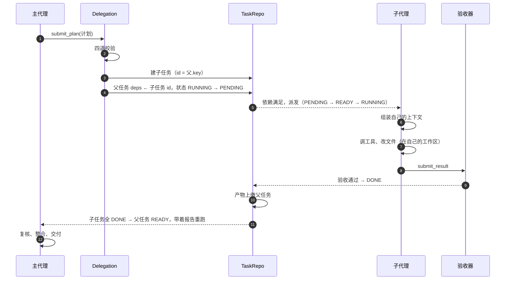

# 子代理机制

[简体中文](SUBAGENTS.md) · [English](SUBAGENTS.en.md)

> 子代理不是"一个会写代码的模型进程"，而是三样东西的组合：
> **一条任务记录 + 一份独立上下文 + 一个独立工作区**。
>
> 所有 agent 跑在同一个事件循环里，隔离靠的是这三样，不是靠进程。

---

## 1. 生命周期



一句话概括：**主代理只负责"决定和验收"，子代理只负责"在自己的围墙里把一件事做完"**，
两者之间的唯一通道是任务记录。

---

## 2. 创建

### 2.1 谁决定

主代理。它调用 `submit_plan`，把计划作为**工具参数**提交（不是自由文本），
参数结构由 `Plan` 这个 pydantic 模型生成。模型必须按 schema 填，我们不需要解析散文。

### 2.2 计划里有什么

```python
Plan:
  reasoning: str                 # 为什么要这么拆，给人看
  roles: list[RoleDraft]         # 这次需要的新角色
  subtasks: list[SubtaskSpec]    # 最多 6 个

RoleDraft:
  name / title / description     # 叫什么、干嘛的
  tools: list[str]               # 它能用哪些工具
  reason: str                    # 为什么现有角色不够用（必填）

SubtaskSpec:
  key: str                       # 计划内的局部 id
  goal: str                      # 自包含的目标
  role: str                      # 用哪个角色
  deps: list[str]                # 依赖哪些兄弟任务
  acceptance: list[Acceptance]   # 机器可判的验收项
```

### 2.3 四道校验（`Delegation.validate`）

| 校验 | 拒绝的情况 | 原因 |
|---|---|---|
| 图合法性 | 依赖成环、依赖不存在的 key | 环会让任务永远等下去 |
| 数量与深度 | 子任务 > 6、深度 > 2 | 防止拆成不可控的大树 |
| 角色可用性 | 既不是已有角色、也没在 `roles` 里声明 | 否则子任务会找不到人做 |
| 工具存在性 | 声明了注册表里没有的工具 | 否则运行到一半才发现调不动 |
| 主代理不可派 | 子任务指名 `planner` | 那个角色拥有整个任务，不能当手下 |

校验失败不是崩溃，而是把 `DelegationError` 的文本回给模型，让它重写计划。

### 2.4 落库

| 动作 | 结果 |
|---|---|
| 角色 | 写进 `roles` 表，**项目级**，下次可以直接复用（先查后建） |
| 子任务 | 写进 `tasks` 表，`id = 父任务 id + "." + key` |
| 父任务 | `deps` 被改写成子任务 id，状态 `RUNNING → PENDING` |
| 事件 | 两件事都记一条 audit event |

父任务变成 `PENDING` 不是"挂了"，而是**"我交出去了，等他们回来"**——它的依赖现在就是子任务，
子任务全部 `DONE` 时它会自动回到 `READY`。

### 2.5 实例化

子任务被调度时才创建运行实例：

```
agent_id = f"{role.name}@{task.id}"          例：python_dev@t1.code
工作区   = runs/<项目>/<对话>/<agent_id>/      每个实例一个目录
```

同一个角色的多个实例**共享记忆命名空间，但不共享工作区**——这是"经验可以复用，文件不能串"。

---

## 3. 上下文：子代理能看到什么

### 3.1 四层，但有严格的准入

| 层 | 内容 | 从哪来 |
|---|---|---|
| 角色 | 两行简报 + 框架规则 | `RoleSpec` + `prompts.FRAMEWORK_RULES` |
| 任务 | 目标、验收项、上游报告 | 自己这条 `TaskNode` + 依赖的报告 |
| 经验 | 检索到的 3–5 条历史教训 | `Retriever.fetch` |
| 对话 | 自己的工具调用历史 | 运行时累积 |

**上游报告只收 `DONE` 的**：状态是 `DEAD` 的依赖只给一行错误，不贴它的全过程。

### 3.2 看不到什么

| 看不到 | 为什么 |
|---|---|
| 父代理的对话 | 子代理根本不该知道主代理在纠结什么 |
| 兄弟任务的对话 | 它们可能并行跑，互相干扰 |
| 其他对话、其他项目 | 作用域隔离 |
| 完整执行日志 | 需要时查文件，不塞进 prompt |

所以主代理写目标时必须**自包含**——这是主代理提示词里专门强调的一条。

### 3.3 开场预算 8k

开场消息（角色 + 简报 + 经验）有 8k 的上限，超了按固定顺序砍：

```
上游报告 6→3→1 → 经验 5→3→1 → 目标截断到 200 字
```

角色说明永远不砍——模型忘了自己在干什么，比少看一个依赖报告严重得多。

### 3.4 运行中压缩：600k → 256k

一个子任务跑 100 步也是可能的。压缩在**每次调模型之前**检查：

| 项 | 值 |
|---|---|
| 触发 | 估算 token > 600,000 |
| 目标 | 一次砍到 256,000 |
| 粒度 | **整轮**（assistant + 它的全部工具结果），绝不拆开 |
| 固定前缀 | 前 2 条（角色 + 简报）**永不压缩** |

三层递进：先确定性压缩工具输出 → 再按整轮丢弃最老的轮次 → 最后才（默认关闭）调模型摘要。

为什么是 600k：`deepseek-flash` 窗口 1M、最大输出 384K，可用 prompt 上限 616K，留 16K 余量。

---

## 4. 记忆：子代理怎么积累和复用

| 类型 | 作用域 | 谁写 | 谁读 | 生命周期 |
|---|---|---|---|---|
| 工作记忆 | 本任务 | 运行时 | 自己 | 任务结束即销毁 |
| 共享工作记忆（结论板） | 项目+对话+角色 | 任务终态时框架写 | 同角色新实例 | 跟对话 |
| 情景记忆 | 项目 | 任务表 + 事件表 + trace | 反思、报告 | 长期只读 |
| 语义记忆 | 项目+角色 | 反思 | 检索后注入 | 长期，会淘汰 |

**结论板**解决的是"同角色第二个实例别重复第一个的弯路"。条目就三样：改了什么文件、
做了什么决策、留了什么话。

**语义记忆**只在值得的任务上写：失败、有重试、或步数 > 8。写进去的条目会被打分，
被引用后成功 +0.2、失败 −0.3，长期不用 ×0.9，低于 0.3 软删除。

---

## 5. 通信：主代理 ↔ 子代理

### 5.1 下行：怎么把活派清楚

只有一条路——`SubtaskSpec`。主代理能传的就是这四个字段：目标、验收项、角色、依赖。
**没有"顺便说一句"的通道**，这正是子代理目标必须自包含的原因。

### 5.2 上行：`submit_result` 结构化交接

子代理干完调用 `submit_result`：

```python
TaskResult:
  summary: str        # 一句话结论
  files: list[str]    # 改了哪些文件
  notes: str          # 下一个接手的人要知道什么
  blockers: list[str] # 还没解决的问题
```

框架把它存成 JSON，父代理拿到时按字段渲染，**上限 3k 字符**（原来是 800，截断经常切掉重点）。

如果子代理没调这个工具、直接回了一段文字，框架会把它包成 `TaskResult(summary=文本)`——
旧行为仍然可用，只是信息密度低。

### 5.3 为什么不走群聊

现在子代理**不能中途找主代理**，只能问人类（`ask_human`）。真团队里应该能问上级，
但那需要一条返回通道 + 把父任务唤醒 + 处理"父任务正在等子任务又收到子任务的消息"这类状态，
属于结构性改动。

它**不影响其他三个人的模块**（不碰任何端口），所以随时可以加，只是现在不做。

### 5.4 失败时会发生什么

| 情况 | 现在的处理 |
|---|---|
| 子代理验收不过 | `FAILED` → 重试（最多 2 次）→ 仍失败则 `DEAD` |
| 子代理 `DEAD` | **父任务被唤醒**（`PENDING → READY`），带上失败原因重跑 |
| 父任务重派 | 新子任务 id 带轮次前缀 `t1.r1.a`，避免和第一轮撞 id |
| 唤醒次数用完 | 每次唤醒计一次，超过 2 次父任务转 `DEAD` |

父任务被唤醒时，简报里会看到失败子任务的那一行：

```
### t1.a — python_dev — FAILED
reason: tests kept failing
```

主代理的提示词里已经写好了该怎么办：**不要原样甩给人类，开一个新的专家，把当前情况和错误交给它。**
如果连续失败两次，就直接说明并列出可选项。

---

## 6. 参数总表

| 参数 | 默认 | 位置 |
|---|---|---|
| 每个计划最多子任务 | 6 | `MAX_SUBTASKS` |
| 最大拆解深度 | 2 | `MAX_DEPTH` |
| 父任务最多被唤醒次数 | 2 | `MAX_WAKEUPS` |
| 单次交接最大字符 | 3000 | `MAX_RESULT_CHARS` |
| 开场消息预算 | 8000 token | `ContextPolicy.opening_budget_tokens` |
| 压缩触发 / 目标 | 600k / 256k token | `ContextPolicy` |
| 注入经验条数 | 3–5 | `ContextPolicy.memory_top_k` |
| 结论板读取条数 | 3 | `ContextPolicy.board_entries` |

---

## 7. 已知限制

| 限制 | 影响 | 备注 |
|---|---|---|
| 子代理不能中途找父代理 | 卡住时只能问人类，或在自己的上下文里硬扛 | 无外部耦合，可后补 |
| 工具权限只有存在性校验 | 子代理可以被授予 `shell` 这类工具 | 每次危险调用仍需人工审批，两道闸剩一道 |
| 角色描述会老化 | 第一个任务造的角色，第十个任务还在用 | 角色评审要解决的就是这个 |
| 父任务被唤醒时看不到子任务的完整过程 | 只有一行错误摘要 | 想看细节得查 trace |
